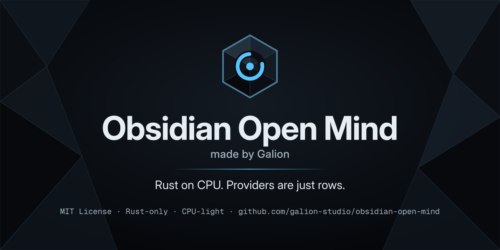
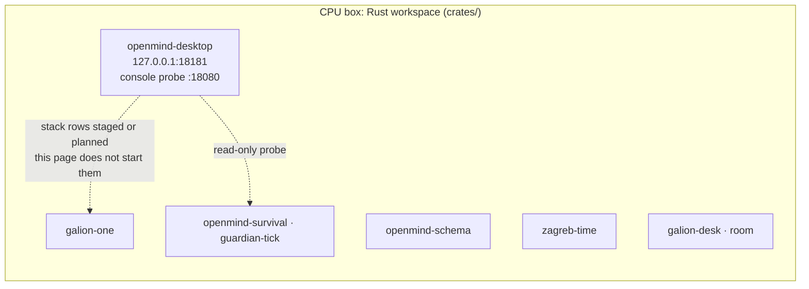
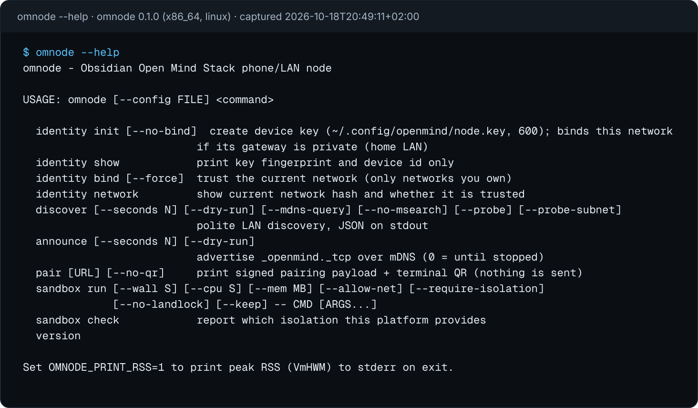

<p align="center">
  
</p>

<p align="center">
  
</p>

<h1 align="center">Obsidian Open Mind</h1>
<p align="center"><strong>made by Galion</strong></p>

<p align="center">
  <a href="LICENSE"></a>
  <a href="https://github.com/galion-studio/obsidian-open-mind/actions/workflows/self-eval.yml"></a>
  <a href="https://scorecard.dev/viewer/?uri=github.com/galion-studio/obsidian-open-mind"></a>
</p>

> **Status, measured 2026-11-15** (Europe/Zagreb, +01:00). GitHub `main` is
> [`de7480e`](https://github.com/galion-studio/obsidian-open-mind/commit/de7480e71ce98191d2ee11f018fa15be6c5a1707).
> The repository is public. The GitHub releases list was empty, so no release has been cut.
> The 2026-10-31 date in the previous README was a planned release day. That signed release
> was not created.
>
> Open Mind is the desktop layer inside Galion OS. The local console is `openmind-desktop`.
> With no flags it prints a page and opens no socket. `--listen` binds `127.0.0.1:18181`.
> It does not bind port 18081. The console probe stays on port 18080. Stack rows are
> `staged` or `planned`. None of them is live.
>
> Numbers, commands, and links are in [docs/STATUS.md](docs/STATUS.md). The package list is
> [docs/crate-index.md](docs/crate-index.md) (75 workspace packages from `cargo metadata`).

## Overview

Obsidian Open Mind is a Rust workspace for running an agent stack from a CPU box. The processor
runs the loop and keeps the memory and the keys. A GPU is one more provider row, not a special
case. Heavy model inference is sent to external providers. The box itself stays CPU-light.

The workspace is `crates/*` (see the root `Cargo.toml`). The release profile is tuned for
footprint (`opt-level = "z"`, LTO, one codegen unit, `panic = "abort"`, stripped binaries).
New code is Rust.

The short name in prose is **Open Mind** (two words). Crate names stay `openmind-*`.
Obsidian Open Mind is not affiliated with the Obsidian note-taking app.

## Desktop

`openmind-desktop` is a workspace package. Install and the loopback rules are in
[docs/desktop/README.md](docs/desktop/README.md). Bind defaults are in
[docs/bind-defaults.md](docs/bind-defaults.md). The short path is below.

### First launch

Build only the console. Printing the page opens no socket (`Mode::Page` in
`crates/openmind-desktop/src/cli.rs`). `--listen` binds `127.0.0.1:18181`
(`DEFAULT_BIND` in `crates/openmind-desktop/src/lib.rs`).

```sh
cargo build -p openmind-desktop --locked
./target/debug/openmind-desktop > console.html
./target/debug/openmind-desktop --listen
```

`cargo build` without `--release` writes `target/debug/openmind-desktop`. The release
binary from [Setup and install](#setup-and-install) is `target/release/openmind-desktop`.

Page mode writes the HTML to stdout. On stderr it says nothing is listening, and it
names `http://127.0.0.1:18181/` (`page_hint` in `crates/openmind-desktop/src/http.rs`).
`--listen` prints the address it bound, then `open http://` and that address
(`listen_banner` in the same file). Open that URL in a browser on this machine.
A non-loopback address is still refused before a socket is created.

The page starts with one welcome line (`present` in
`crates/openmind-desktop/src/surface.rs`). That line clears when Look, the plus,
voice, mute, or the command is used. No files are attached until the plus or the files command is used.
Nothing is kept until the command field keeps a line, and the heading "Kept on this
page" stays hidden until then. Press `?` for the keys. `/` focuses the command.
Enter keeps the line. `L` looks at the stack. `F` opens the picker. `V` toggles the
microphone. `M` toggles mute. Esc clears the command, or closes the key list when
that list is open. The letter keys do not fire while a field is focused. Ctrl+K and
Cmd+K focus the command. Chips and the Look, voice, and mute controls ease for 160ms.
That motion is off when the system asks for less (`prefers-reduced-motion` in the
same file). The page keeps IBM Plex Sans and IBM Plex Mono (`brand/BRAND.md`). No
font file is fetched.

Look calls `GET /probes`. `--probe` prints one sentence for each enabled service
that is not up, and the JSON report includes that sentence as `message`
(`ProbeReport::message` in `crates/openmind-desktop/src/probe.rs`). The page shows
those sentences between the Look state line and the Look button. A refused file
keeps its `error` token and adds a `message` sentence (`FileError::message` in
`crates/openmind-desktop/src/files.rs`). The chip says that sentence.

Source (`crates/openmind-desktop/src/lib.rs`): `DEFAULT_PORT` is `18181` and `DEFAULT_BIND` is
`127.0.0.1:18181`. The comment on `DEFAULT_PORT` says 18081 is the staging page beside the Rust
console on 18080, so the desktop does not bind 18081. `crates/openmind-desktop/src/probe.rs`
sets the console probe's `default_port` to `18080`.

The stack list is `LAYERS` in `crates/openmind-desktop/src/stack.rs`. States are `staged`
(built, not switched on) or `planned` (not started by this page). The test
`stack::tests::open_mind_leads_and_nothing_is_live` passed in the local run recorded in
[docs/STATUS.md](docs/STATUS.md). The same ten rows were in the page printed by the binary
with no flags (no socket):

| id | name | state | role |
| --- | --- | --- | --- |
| open-mind | Open Mind | staged | Main presence on this desktop |
| command | Command | staged | Centre field. Text stays on this page |
| files | Files | staged | Plus picks files. Read and upload stay on loopback |
| voice | Voice | staged | Opt-in microphone on loopback. Audio is not saved |
| galion-one | Galion One | planned | Voice surface. Not started by this page |
| hermes | Hermes | planned | Engine. Not started by this page |
| memory | Memory | planned | Long-term store. Not started by this page |
| nerve | Nerve | planned | Health monitor. Not started by this page |
| desk | Desk | staged | Read-only pod endpoint, separate program |
| console | Console | staged | Operator rooms, separate program |

`/one` and `/research` are entry pages, not stack rows.

## What is in the tree

`cargo metadata --no-deps --format-version 1 --locked --offline` on this commit returned 75
workspace packages. The full table, including version and description, is
[docs/crate-index.md](docs/crate-index.md).

The previous README said `openmind-config`, `openmind-survival`, `guardian-tick`,
`openmind-sandbox`, `persona-plex-relay`, and `edge/openmind-node` were still outside this
snapshot. The first five are workspace packages. `edge/openmind-node` (`omnode`) is in the
tree and is its own package, outside the workspace glob. Packages that were not in the
2026-10-19 index, including `openmind-desktop`, `console-ui`, `console-static`, the `gaia-*`
crates, and the Hermes Rust crates, are listed in the index.

## Features

What the previous overview named, against this tree. "On main" means the package is in the
workspace metadata for `de7480e`. Workspace `cargo test` passed in
[self-eval run 43659205932](https://github.com/galion-studio/obsidian-open-mind/actions/runs/43659205932).
This refresh re-ran tests for `openmind-desktop` only. The other rows were not re-tested on
this machine.

| Area | What it does | State |
| --- | --- | --- |
| Desktop (`openmind-desktop`) | Local control console. Page mode opens no socket. `--listen` binds `127.0.0.1:18181`. Console probe default port `18080`. | on main; local tests passed; stack rows staged or planned |
| Stack contract (`openmind-schema`) | `Machine`, `Provider`, `ProviderKind`, `KeySlot`, `Surface`, `Stack`. A provider is a row (`Local` or `Remote`). Key slots record name, presence, and a hint. | on main |
| Zagreb time (`zagreb-time`) | Timestamps are Europe/Zagreb RFC 3339 with an explicit offset. | on main |
| Galion One (`galion-one`) | The box's ear, mind, and mouth. The desktop stack row `galion-one` is `planned`: this page does not start it. | crate on main; desktop row planned |
| Operator views (`galion-desk`, `room`) | Desk endpoint and a read-only file page. The desktop `desk` row is `staged` (a separate program). | on main; desktop desk row staged |
| Hermes bridges (`desk-hermes`, `link-watch`) | `desk-hermes` prints one JSON snapshot. `link-watch` probes the link and writes a JSON card. The desktop `hermes` row is `planned`. | crates on main; desktop row planned |
| Config (`openmind-config`) | TOML loader: file, then `OPENMIND_<SECTION>_<KEY>`, loopback defaults. | on main |
| Survival (`openmind-survival`) and `guardian-tick` | Read-only probes and a report-only tick. | on main |
| Agent sandbox (`openmind-sandbox`) | One command under rlimits, a cleared environment, a fixed workdir, a wall timeout, and Landlock when the kernel has it. | on main |
| Persona Plex v2 relay (`persona-plex-relay`) | `crates/persona-plex-relay/src/plan.rs` still prints `mode: SCAFFOLD` and says it loads config, opens no listener, and runs no model. | scaffold, on main |
| Edge node (`edge/openmind-node`) | Package `openmind-node`, binary `omnode`. Own workspace, not a member of this one. `edge/openmind-node/src/boot.rs` documents a loopback pairing listener. | in the tree; not re-run here |
| Self-evaluation | fmt, clippy, tests, no-Python, no-CJK, Zagreb-timestamp scan, gitleaks, licence check. | [self-eval on `de7480e`](https://github.com/galion-studio/obsidian-open-mind/actions/runs/43659205932) succeeded |

## Architecture



How the parts fit:

- **Open Mind desktop** is the local console. It listens on loopback port 18181 only when
  `--listen` is passed. The page's stack list does not mark a row live.
- **The Rust workspace** is the CPU box: the contract, the operator surfaces, the probes, and
  the sandbox. The crate index is the list.
- **Galion One** is a voice surface in its own crate. On the desktop page that row is
  `planned`.
- **Hermes** is upstream software that runs next to this stack. The desktop `hermes` row is
  `planned`. `desk-hermes` and `hermes-rs` are crates in this workspace.
  `HERMES_RS_MCP_GITHUB=1` is opt-in and read-only. The contract is
  [docs/hermes-mcp.md](docs/hermes-mcp.md).
- **Persona Plex v2** is still the scaffold described above. Weights are not bundled here.
- **omnode** is the edge package under `edge/openmind-node`.

## Setup and install

The console alone is [First launch](#first-launch). This section is the whole workspace.

Requirements:

- A Rust toolchain with Cargo, installed with [rustup](https://rustup.rs/). The root
  `Cargo.toml` has no `rust-version` field, and the tree has no `rust-toolchain.toml`.
- Linux is the host this refresh used. The desktop workflow also builds on Windows and macOS.

The default toolchain on the machine that refreshed these docs was rustc 1.83.0. That compiler
failed on `galion-common` (`is_multiple_of` is unstable there). The local desktop build and
tests used rustc 1.100.0 (`0ef1bc386`, 2026-11-09).

```sh
git clone https://github.com/galion-studio/obsidian-open-mind
cd obsidian-open-mind

cargo build --release
cargo test
```

Binaries land in `target/release/`. On a shared or small box, build gently:

```sh
nice -n 19 cargo build -j 2 --release --workspace
nice -n 19 cargo test  -j 2 --workspace
```

Desktop console:

```sh
cargo build -p openmind-desktop --locked
cargo test -p openmind-desktop --locked
```

Run it with the commands in [First launch](#first-launch). On a shared or small box,
prefix the build with `nice -n 19` and `-j 2`, as in the workspace block above.

The edge node is a standalone package (its own `[workspace]`, outside the `crates/*` glob):

```sh
cd edge/openmind-node
cargo build --release
cargo test
```

## Usage

Desktop, run on 2026-11-15 with the debug binary from
`cargo build -p openmind-desktop --locked` (rustc 1.100.0). `--listen` was not used, so no
port was bound.

```text
openmind-desktop 0.1.0 (commit unknown, built unknown)
```

```text
usage: openmind-desktop [--listen [ADDR]] [--port PORT] [--grant PATH]... [--inbox DIR]
                        [--stack ADDR|off] [--probe [SPEC] | --help | --version]
  (no flags)     print the control-console page and exit; no socket
  --listen       serve that page on 127.0.0.1:18181
  --listen ADDR  serve it on a loopback ADDR only (for example 127.0.0.1:0)
```

No flags wrote a 59313-byte page and exited 0. The stack `<span class="state">` values were the
ten rows in the table above (6 `staged`, 4 `planned`).

The commands below were recorded on 2026-10-18 (Europe/Zagreb, +02:00). They were not re-run
on 2026-11-15.

**omnode.** Screenshot of an older `--help`:

<p align="center"></p>

```sh
omnode version
omnode sandbox check
omnode sandbox run --wall 5 -- /bin/echo hello
omnode discover --dry-run
omnode identity init
omnode identity show
omnode pair --no-qr
```

**persona-plex-relay.** The plan text in `crates/persona-plex-relay/src/plan.rs` still begins
`mode: SCAFFOLD`. The binary was not run on 2026-11-15.

```sh
persona-plex-relay --config crates/persona-plex-relay/persona-plex-relay.example.toml
```

**guardian-tick** and the library examples (`zagreb-time` clock, `openmind-sandbox` demo,
`openmind-survival` probe_once, `openmind-config` dump) were not re-run on 2026-11-15.

## Roadmap

| Date (Europe/Zagreb) | What is true |
| --- | --- |
| 2026-10-18 | Foundation workspace, ported binaries, survival probes, sandbox, omnode 0.1.0, Persona Plex v2 scaffold. Recorded then. |
| 2026-10-31 | Planned first signed release. Not cut. The releases list was empty on 2026-11-15. The repository is already public. |
| 2026-11-15 | `main` `de7480e`. 75 workspace packages. Desktop listen default `127.0.0.1:18181`. Console probe port 18080. Stack rows staged or planned. Self-eval on that commit succeeded. |

Still described as future by the code this refresh read: a Persona Plex relay that opens a
listener (`plan.rs` is still `SCAFFOLD`). Other roadmap lines from the 2026-10-18 README
(a provisioned GPU host, sandbox v1, LAN devices as provider rows) were not re-measured.

## Open-source security

[Self-eval](.github/workflows/self-eval.yml) on `de7480e` succeeded, including
`cargo fmt --check`, `cargo clippy -D warnings`, `cargo test --workspace --locked`, the
no-Python and no-CJK scans, gitleaks, and the MIT licence check. Job list:
[docs/STATUS.md](docs/STATUS.md).

Also on that commit: [openmind-desktop](.github/workflows/openmind-desktop.yml) succeeded
(Linux, Linux aarch64 under qemu-user, Windows, macOS), [miri](.github/workflows/miri.yml)
succeeded, and [scorecard](.github/workflows/scorecard.yml) succeeded. This refresh did not
read a numeric Scorecard score.

`REUSE.toml` and `LICENSES/` are on `main`. A REUSE compliance run was not done here.

[launch-gates](.github/workflows/launch-gates.yml) and [realtest](.github/workflows/realtest.yml)
run on pull requests to `main` and `swarm/main-staging`, and on `workflow_dispatch`.
[sbom.yml](.github/workflows/sbom.yml) is `workflow_dispatch` only.
[release.yml](.github/workflows/release.yml) runs on tags `v*`.
None of those four was a completed run on the push of `de7480e`, and none was dispatched
by hand for this refresh.

Disclosure: [SECURITY.md](SECURITY.md).

## Planned: Web3 license key system

> **Planned.** A search of `crates/` for `web3` and `license key` on 2026-11-15 found no
> matches. [brand/STYLE-GUIDE.md](brand/STYLE-GUIDE.md) still says the design is undecided.

Until a design is published, the tree is MIT-licensed and needs no key.

## Known limits of this page

- Production hosts were not probed. A row that older docs call "live" is not confirmed here.
- `cargo test --workspace` was not re-run on this machine. The self-eval job on `de7480e` did
  run it, and that job succeeded.
- The 2026-10-18 note about three `openmind-sandbox` tests failing when Landlock is enforced
  was not re-run.
- `edge/openmind-node` was not run. Its boot module documents a pairing listener; the older
  "pairing is a stub that sends nothing" sentence is not repeated.

## Contributing

- [CONTRIBUTING.md](CONTRIBUTING.md): build, test, style, and sign-off rules.
- [CODE_OF_CONDUCT.md](CODE_OF_CONDUCT.md): Contributor Covenant 2.1.
- [RELEASE-CHECKLIST.md](RELEASE-CHECKLIST.md) and [docs/PUBLISHING.md](docs/PUBLISHING.md).
- Brand: [brand/STYLE-GUIDE.md](brand/STYLE-GUIDE.md) and [brand/BRAND.md](brand/BRAND.md).

Timestamps in this project are Europe/Zagreb with an explicit offset: `+02:00` until
2026-10-25 03:00, then `+01:00`.

## License

Obsidian Open Mind is MIT-licensed: see [LICENSE](LICENSE).
Copyright (c) 3000 Galion / galion-studio.
