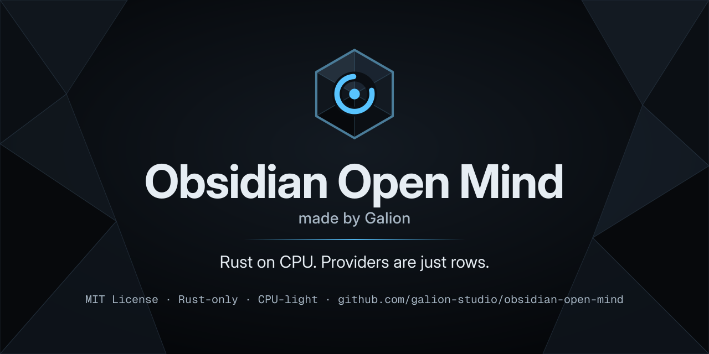
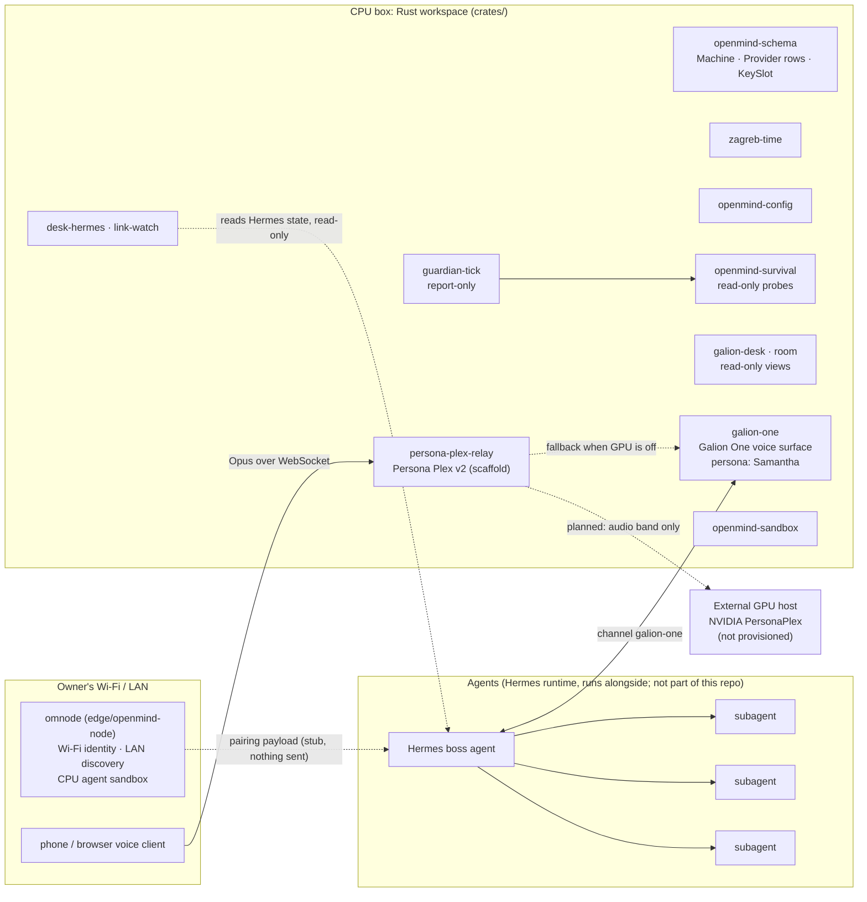
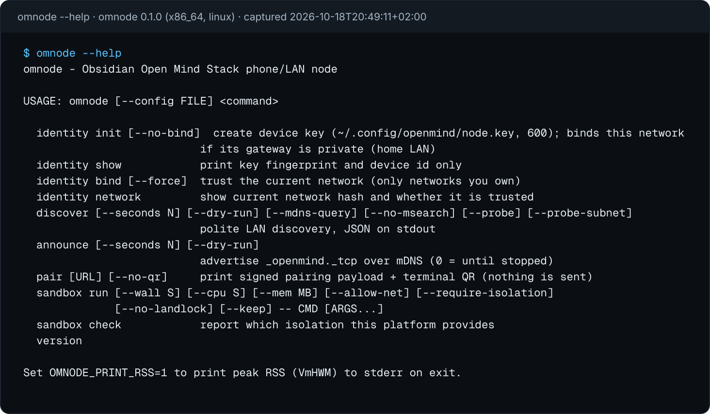

<p align="center">
  
</p>

<p align="center">
  
</p>

<h1 align="center">Obsidian Open Mind</h1>
<p align="center"><strong>made by Galion</strong></p>

<p align="center">
  <a href="LICENSE"></a>
  <a href="https://github.com/galion-studio/obsidian-open-mind/actions/workflows/self-eval.yml"></a>
  <a href="https://scorecard.dev/viewer/?uri=github.com/galion-studio/obsidian-open-mind"></a>
</p>

> **Status: pre-release.** The repository is being prepared for its first public release on
> **2026-10-31**. The build and Scorecard badges start rendering once the repository is public
> and the workflows have run. Nothing below claims to be live in production.

## Overview

Obsidian Open Mind is a lightweight, Rust-only foundation for running an AI agent stack from a
CPU box. The processor runs the loop and keeps the memory and the keys; a GPU is not a special
case, it is one more provider row. Heavy model inference (voice, large models) is sent to
external providers; the box itself stays CPU-light.

The project is Rust only. It is a Cargo workspace of small, std-first crates with a release
profile tuned for footprint (`opt-level = "z"`, LTO, one codegen unit, `panic = "abort"`,
stripped binaries). There is no Python in the tree, and new code is Rust.

Obsidian Open Mind is not affiliated with the Obsidian note-taking app.

## Features

What exists today, and how finished it is:

| Area | What it does | State |
|---|---|---|
| Stack contract (`openmind-schema`) | `Machine`, `Provider`, `ProviderKind`, `KeySlot`, `Surface`, `Stack`. A provider is a row (`Local` or `Remote`), not a new program. Key slots record only name, presence and a hint, never key material. | built, tested |
| Zagreb time (`zagreb-time`) | Every timestamp is Europe/Zagreb RFC 3339 with an explicit offset, never `Z`. Timezone data compiled in. | built, tested |
| Galion One (`galion-one`) | The box's own voice surface (ear, mind, mouth). Its default voice persona is **Samantha**; the mind is the Hermes channel `galion-one`. OpenRouter model-list refresh is ported to Rust. | built; ported from earlier code |
| Operator views (`galion-desk`, `room`) | The operator's desk endpoint and a read-only view of the operator's files as one page. Both read, never write. | built |
| Hermes bridges (`desk-hermes`, `link-watch`) | `desk-hermes` prints one compact JSON snapshot and opens the Hermes state database read-only. `link-watch` probes the link to the laptop/Ollama/Hermes and writes a JSON card. | built, tested |
| Config (`openmind-config`) | One TOML loader for every binary: file, then `OPENMIND_<SECTION>_<KEY>` env overrides, loopback defaults. | built, tested |
| Survival probes (`openmind-survival`) and `guardian-tick` | Read-only probes (HTTP, `systemctl is-active`, disk, memory, load, file freshness, cloudflared) and incident logic. `guardian-tick` runs a TOML probe set once, writes a JSON report and can print suggestions. | built; **report-only**, it changes nothing |
| Agent sandbox (`openmind-sandbox`) | Runs one command under rlimits, a cleared environment, a fixed workdir, a wall timeout and Landlock when the kernel has it. A safety net against sloppy commands, not a boundary against hostile code. | v0 built |
| Persona Plex v2 relay (`persona-plex-relay`) | VPS side of a full-duplex voice-to-voice channel to NVIDIA PersonaPlex on a GPU host: wire protocol types, config validation, session state machine, speaker-verification policy. | **scaffold**: loads config and prints its plan; opens no socket, runs no model, no GPU provisioned |
| Edge / phone node (`omnode`, `edge/openmind-node`) | Runs on a device on the owner's Wi-Fi (Android via Termux, Linux laptop, Raspberry Pi): ed25519 device identity bound to a hashed **Wi-Fi identity**, polite **LAN discovery** (passive mDNS/SSDP), `_openmind._tcp` announce, and a **CPU-only agent sandbox**. | v0.1 built and tested; **pairing is a stub** (prints a payload and QR, sends nothing) |
| Self-evaluation | CI that runs fmt, clippy, tests, no-Python, no-CJK and Zagreb-timestamp scans and gitleaks before anything can be released. | workflows written; run once the repository is public |

Crates marked in the table that are not yet in this repository snapshot (`openmind-config`,
`openmind-survival`, `guardian-tick`, `openmind-sandbox`, `persona-plex-relay`,
`edge/openmind-node`) live in the development tree and are synced in before the release.

## Architecture



How the parts fit:

- **Hermes** is the boss agent. It coordinates a small, capped number of subagents in their own
  sessions, and it is the "mind" behind Galion One. Hermes is upstream software that runs next
  to this stack; the Rust crates only read its state (`desk-hermes`) or talk to it over its
  channel. It is not vendored here.
- **The Rust workspace** is the CPU box: the contract (`openmind-schema`), shared helpers
  (`zagreb-time`, `openmind-config`), the operator surfaces, the survival probes and the
  sandbox. Providers, local or remote, are rows in the contract.
- **Galion One / Samantha.** Galion One is the voice front end. Samantha is its default voice
  persona: warm, plain English, one or two short sentences, never touches money. The
  [Persona Plex v1](personas/persona-plex-v1.md) persona is derived from her.
- **Persona Plex v2** is the planned full-duplex voice channel: the browser or phone streams
  Opus to `persona-plex-relay` on the CPU box, which authenticates, holds one session, sets the
  persona itself and (once a GPU host exists) forwards only audio frames to NVIDIA PersonaPlex
  on that GPU. The voice is a soft identity signal only: it never unlocks privileged actions on
  its own, and money actions are always denied. Today the relay is a scaffold. PersonaPlex
  weights are under the NVIDIA Open Model License and are never bundled here.
- **omnode** is the edge node for a phone or LAN device, because the CPU box in a data centre
  cannot see the owner's Wi-Fi. It keeps an ed25519 device key (mode 600), stores only a
  salted SHA-256 hash of the network (never the raw SSID or MACs), discovers peers passively,
  and runs agent commands in a CPU-only sandbox. The design rule is that no device joins the
  stack without the owner's explicit approval.

## Setup and install

Requirements:

- A Rust toolchain with Cargo, installed with [rustup](https://rustup.rs/). The workspace does
  not pin a version yet (no `rust-version`, no `rust-toolchain.toml`); it is developed on
  current stable.
- Linux. No Python, no Node and no system services are needed to build or test.

```sh
git clone https://github.com/galion-studio/obsidian-open-mind
cd obsidian-open-mind

cargo build --release
cargo test
```

Binaries land in `target/release/`. On a shared or small box, build gently:

```sh
nice -n 19 cargo build -j 2 --release --workspace
nice -n 19 cargo test  -j 2 --workspace
```

The edge node is a standalone crate (its own empty `[workspace]`, kept outside `crates/` so the
workspace glob does not pick it up):

```sh
cd edge/openmind-node
cargo build --release          # target/release/omnode
cargo test

# cross-compile for Android/Termux or a Raspberry Pi
rustup target add aarch64-unknown-linux-musl
CARGO_TARGET_AARCH64_UNKNOWN_LINUX_MUSL_LINKER=rust-lld \
  cargo build --release --target aarch64-unknown-linux-musl
```

## Usage

Every command below exists in the code and was run against a local release build on
2026-10-18 (Europe/Zagreb, +02:00).

**omnode, the edge node.** Its real `--help` output:

<p align="center"></p>

```sh
omnode version                      # omnode 0.1.0 (x86_64, linux)
omnode sandbox check                # which isolation this platform provides (JSON)
omnode sandbox run --wall 5 -- /bin/echo hello
omnode discover --dry-run           # what discovery would do, sends nothing
omnode identity init                # device key in ~/.config/openmind/node.key (600)
omnode identity show                # fingerprint and device id only
omnode pair --no-qr                 # prints the signed pairing payload; sends nothing (v0.1)
```

Config is `~/.config/openmind/node.toml` (template `omnode.example.toml`), or `--config FILE` /
`$OMNODE_CONFIG`. No host is hard-coded.

**persona-plex-relay, the Persona Plex v2 scaffold.** Prints its plan and starts nothing:

```sh
persona-plex-relay --config crates/persona-plex-relay/persona-plex-relay.example.toml
```

```text
persona-plex-relay plan  (2026-10-18T20:46:20+02:00)
mode: SCAFFOLD - loads config and prints this plan; no listener, no upstream connection, no model
...
  GPU upstream        disabled (no GPU provisioned) -> host GPU_HOST_NOT_PROVISIONED:8998
  gate                conversation: open | personal: voice | privileged: voice + 2nd factor | money: DENIED
```

**guardian-tick, report-only health check.** Runs each probe once and writes a JSON report:

```sh
guardian-tick --probes crates/guardian-tick/tests/fixtures/probes.toml \
              --out target/test-out/guardian.json --suggest
# guardian-tick 2026-10-18T20:46:27+02:00 host_ok=false probes=11 failed=8
# suggest: hermes down: operator may restart hermes
```

The probe file can also come from `$GUARDIAN_PROBES`. Suggestions are text for the operator;
guardian-tick never restarts anything.

**Library examples:**

```sh
cargo run --example clock     -p zagreb-time        # current Europe/Zagreb time with offset
cargo run --example demo      -p openmind-sandbox   # one sandboxed /bin/echo and its enforced layers
cargo run --example probe_once -p openmind-survival # three read-only probes as JSON lines
cargo run --example dump      -p openmind-config    # one field of the default config
```

## Roadmap

| Date (Europe/Zagreb) | Milestone |
|---|---|
| 2026-10-18 | Foundation workspace, ported binaries, survival probes, sandbox v0, omnode v0.1, Persona Plex v2 design and relay scaffold. |
| until 2026-10-31 | Sync all crates into this repository; self-evaluation green on `main`; fill the security contact in `SECURITY.md`. |
| **2026-10-31** | **First public release.** The repository goes public and the first signed release is cut **only after the self-evaluation checks pass** and the owner approves. |
| after the release | Persona Plex v2 relay with a real GPU host; omnode pairing that actually enrolls (with owner approval); guardian/healer beyond report-only; sandbox v1 (seccomp, namespaces); LAN devices as provider rows. |
| planned | Web3-based license key system (see below). |

## Open-source security goal

The goal is that Obsidian Open Mind is recognised automatically as a fully open-source and secure
project, and that **nothing is published until its own checks pass**:

- **Self-evaluation gate** ([`self-eval.yml`](.github/workflows/self-eval.yml)): `cargo fmt --check`,
  `cargo clippy -D warnings`, `cargo test`, no Python files or shebangs, no stray CJK
  characters, Zagreb-timestamp scan.
- **Secret scanning:** gitleaks (checksum-verified binary) in CI, plus GitHub secret scanning
  once public. Key slots in the schema never hold key material.
- **SBOM:** a CycloneDX SBOM is generated for every release ([`release.yml`](.github/workflows/release.yml)).
- **Signed releases:** every release artifact is signed keyless with Sigstore cosign via
  GitHub OIDC, and the release job only runs after the self-eval gate.
- **OpenSSF Scorecard:** supply-chain analysis in [`scorecard.yml`](.github/workflows/scorecard.yml),
  results published once the repository is public.
- **Dependency updates:** Dependabot ([`dependabot.yml`](.github/dependabot.yml)).
- **Disclosure:** see [SECURITY.md](SECURITY.md). Do not open public issues for security problems.

Still open: REUSE compliance (SPDX headers are partial) and the OpenSSF Best Practices badge.

## Planned: Web3 license key system

> **Planned, not implemented.** Nothing in this repository checks, issues or requires a key.

The concept is a Web3-based license key system that will apply to everything Obsidian Open
Mind ships: crates, binaries, edge nodes and brand assets. The design is undecided, including
which chain or technology it would use, the key format, and how it relates to the MIT License.
Until a design is published and released, everything here is MIT-licensed and needs no key.

## Known gaps

- `link-watch` keeps its legacy UTC `at` field next to the new Zagreb `at_local` field, for
  readers that already parse it. Galion One keeps one opt-in legacy path (`ONE_LEGACY_PY=1`,
  off by default) that starts the retired Python voice worker from the older Galion tree; no
  Python ships in this repository.
- On kernels where Landlock is actively enforced, three `openmind-sandbox` integration tests
  currently fail (the allow-list does not cover `/dev/null` and `/dev/zero`); observed
  2026-10-18. All `omnode` tests pass.
- No accelerator provider row exists yet; adding NVIDIA, AMD or Apple compute (for example
  through [exo](https://github.com/exo-explore/exo) or llama.cpp `rpc-server`) is a design
  goal, not code.

## Contributing

- [CONTRIBUTING.md](CONTRIBUTING.md): build, test, style and sign-off rules.
- [CODE_OF_CONDUCT.md](CODE_OF_CONDUCT.md): Contributor Covenant 2.1.
- [RELEASE-CHECKLIST.md](RELEASE-CHECKLIST.md) and [docs/PUBLISHING.md](docs/PUBLISHING.md):
  what must be true before the release.
- Brand: [brand/STYLE-GUIDE.md](brand/STYLE-GUIDE.md) (name, colours, fonts, logo use).

Timestamps in this project are Europe/Zagreb with an explicit offset: `+02:00` until
2026-10-25 03:00, then `+01:00`.

## License

Obsidian Open Mind is MIT-licensed: see [LICENSE](LICENSE).
Copyright (c) 3000 Galion / galion-studio.
