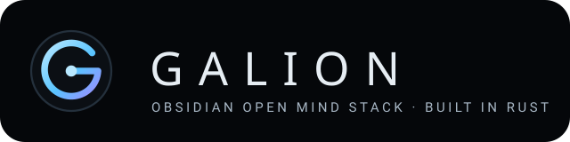

<!-- SPDX-License-Identifier: MIT -->
<!-- Copyright (c) 3000 Galion / galion-studio -->
<p align="center">
  
</p>

<h1 align="center">Galion OS</h1>
<p align="center"><strong>One window. One gradient. Hermes at the centre.</strong></p>
<p align="center">
  Starting with Open Mind and Hermes · <a href="LICENSE">MIT License</a> · Built in Rust · <a href="https://galion.app">galion.app</a>
</p>

Galion OS is the full Galion operating system experience: one window, one gradient,
ultra-minimal, with Hermes at the centre. Its heart and its interface is the **Obsidian Open
Mind** stack in this repository, built in Rust so it stays light and lightning fast, and made
to run on any processor: Linux, Mac, Windows, Android, iPhone and ARM chips such as
Snapdragon. It is open source under the MIT License: free for everybody to download and do
anything with.

Galion OS is where we are heading, not a finished operating system you can install today. It
starts here, with Open Mind and Hermes. What you can use now is **Galion One**, a personal
assistant that lives on your phone, your laptop and the web. It runs light and fast on ordinary
computers, keeps working when you are offline, and it is free and open for everyone.

The Obsidian Open Mind stack is a family of small projects, each doing one job well.

| Project | What it does for you |
|---|---|
| **Galion One** | The assistant you talk to, on your phone, your laptop or the web. |
| **Hermes** | The research agent. It plans the work, shares it out and brings back the results. |
| **Gaia** (cortex, nerve, guard) | Looks after everything. It notices when something is wrong and keeps intruders out. |
| **Open Mind memory** | Remembers what matters to you, kept on your own machine, even offline. |
| **Open Mind MCP stack** | Plugs your assistant into the tools and apps you already use. |
| **Poseidon** | Lines up the work in order and keeps spending inside the limits you set. |
| **Galleon Arena** | A practice ground where agents are tested and scored. |
| **Console** | One calm place to see your devices, keys and approvals. |
| **Your devices** | Add a laptop, a phone or a small computer, and it becomes part of your Galion. |

## Light enough for any computer

- **Built in Rust.** Rust is a programming language known for speed and safety. Galion is
  written in it from top to bottom, so it is small, quick and sturdy.
- **Runs on an ordinary processor.** If one of your machines has a graphics card, Galion uses
  it too, but it never needs one.
- **Yours, even offline.** Connect any laptop or device and it serves you at home, on your own
  network. To answer, it uses an AI model you choose: one on your own computer, or an online one.

## Private by design

No email and no personal details. You get an account number, and that number is your account,
so keep it safe. Pay by card (Stripe), crypto or cash by post.

## Plans

One subscription covers everything on galion.app, Galion One included. Prices in euros.

| Free | Plus | Pro |
|---|---|---|
| **€0** | **€20 / month**, one person | **€220 / month** |
| Private, open source (MIT), run it locally: download it, run it yourself, do whatever you want with it. | The whole platform hosted for you, no setup. | Your own Hermes agent gets its own computer and SSD in the cloud, to do real work for you. For people without a powerful computer or a graphics card at home. |
| Available now | Coming soon | Coming soon |

Paid plans are not open yet; there is nothing to pay today. Payments design: [docs/payments/galion-home-checkout.md](docs/payments/galion-home-checkout.md).

## Quick start

**On the web.** Open [one.galion.app](https://one.galion.app). Nothing to install.

**On your own computer (localhost).** You need [Rust](https://rustup.rs/) and Linux.

```sh
git clone https://github.com/galion-studio/obsidian-open-mind
cd obsidian-open-mind
cargo build --release
```

**Download.** The Android and iOS apps are coming soon.

The technical overview (crates, architecture, setup details) is in
[docs/README-technical.md](docs/README-technical.md).

## License

MIT. See [LICENSE](LICENSE). Obsidian Open Mind is not affiliated with the Obsidian
note-taking app.
