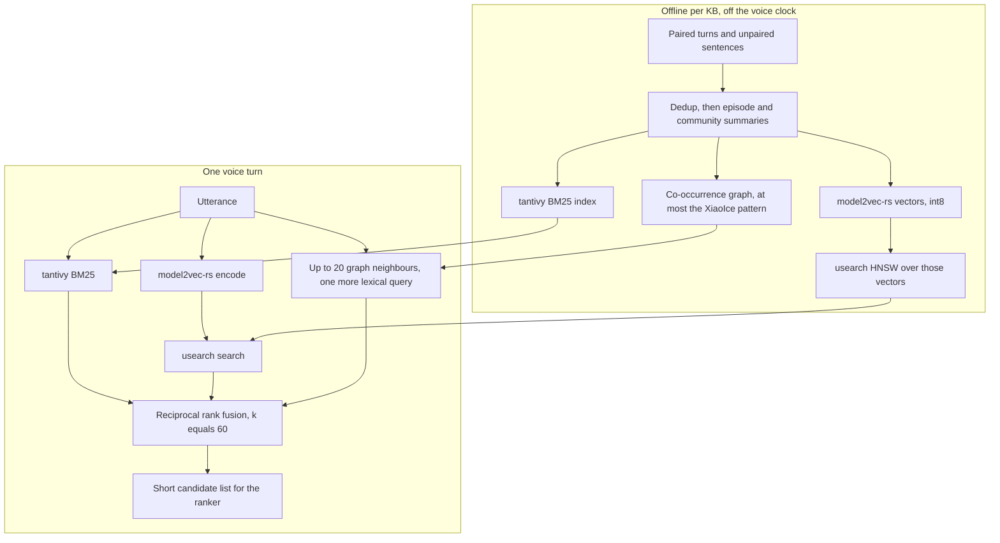

<!-- SPDX-License-Identifier: MIT -->
<!-- SPDX-FileCopyrightText: 3000 Galion / galion-studio -->

# HORBM R1: retrieval core

Research note only. No product code, no benchmark run, no model or dataset download, no paid API call.

Written 2026-11-18. Pages below were read that day. This note does not measure Galion hardware.

Labels used on load-bearing claims:

- **Fact.** A number or design point taken from the named source.
- **Vendor.** A figure published by the project that ships the code, not by a peer-reviewed paper.
- **Derived.** Arithmetic on a published figure. Not a new measurement.
- **Opinion.** A recommendation for HORBM. Not a result.
- **Unknown.** Looked for, not found in the sources read here.

The voice-turn budget of roughly under 100 ms for retrieval is a design constraint of this HORBM brief. It is not a measured XiaoIce or Galion latency. Khattab and Zaharia (SIGIR 2020) cite Kohavi et al. (2013) for a different claim: raising web-search response time by as little as 100 ms affects user experience and revenue. That citation is about web search, not a spoken turn.

## 1. What XiaoIce actually retrieves

**Fact.** Li Zhou, Jianfeng Gao, Di Li, and Heung-Yeung Shum, "The Design and Implementation of XiaoIce, an Empathetic Social Chatbot", arXiv:1812.08989 (December 2018).

XiaoIce's core chat is not a generator-first system. Two of the three candidate generators are Lucene indexes (http://lucene.apache.org/, as cited in the paper):

- **Paired.** Query-response pairs from the public web and, after the May 2014 release, from XiaoIce's own chats. The paper says this human-machine set was more than 30 billion pairs as of May 2018, and that 70% of responses were by then retrieved from XiaoIce's own past conversations. Each kept pair is a tuple of contextual query, response, and two empathy vectors. At runtime the contextual query retrieves up to 400 candidates by keyword search plus semantic search on machine-learned representations. The semantic part is cited as Zhang et al. (WSDM 2016) and Wu, Wang, and Xue (COLING 2016). The paper does not describe those representations as a modern bi-encoder, and it does not give their dimension, index type, or latency.
- **Unpaired.** Sentences from lectures and news, indexed in Lucene, filtered to the persona. The query is expanded with a knowledge graph so the reply does not echo the user. The graph is head-relation-tail triples from Microsoft Satori kept only when the head and tail co-occur often enough in the paired conversations (head in the query and tail in the response, or the reverse). For each topic in the query, XiaoIce takes up to 20 related topics, scored by a boosted-tree ranker (Wu, Burges, Svore, and Gao, Information Retrieval, 2010) trained on manual labels. The original topics plus the related topics form one Lucene query, which returns up to 400 unpaired candidates.

A third generator is a neural sequence model. All candidates are then ranked by the same boosted-tree ranker. The product objective is expected conversation-turns per session (CPS). The paper reports an average CPS of 23 for the 6th generation in July 2018. It does not report milliseconds for Lucene, for the semantic index, or for the graph expansion.

**Unknown.** XiaoIce retrieval latency, Lucene version, index size in bytes, and the 2016 semantic-search architecture beyond the two citations.

**Opinion.** HORBM should keep the shape (paired memory, unpaired knowledge, a small co-occurrence graph, a later ranker) and replace the 2018 machinery underneath it. It should not copy the web scale. Thirty billion pairs is a cluster index. A per-KB "diary" is a resident index on a CPU.

Zhang et al. 2016, as cited by Zhou et al.: Kai Zhang, Wei Wu, Fang Wang, Ming Zhou, and Zhoujun Li, "Learning distributed representations of data in community question answering for question retrieval", WSDM 2016. Wu et al. 2016: Bowen Wu, Baoxun Wang, and Hui Xue, "Ranking responses oriented to conversational relevance in chat-bots", COLING 2016.

## 2. Recommended shape

**Opinion.** The solid path above is the stack in section 7. If the embedder or the vector index is absent, or a probe shows it does not fit the remaining budget, the turn is the lexical branch only. GraphRAG, HippoRAG, and full late-interaction search stay in the offline box or off the machine. They are compilers and rerankers, not the first hop of a spoken turn.

## 3. Sparse, dense, and hybrid retrieval

### 3.1 BM25 and tantivy

**Fact.** Carlos Lassance and Stéphane Clinchant, "An Efficiency Study for SPLADE Models", SIGIR 2022 (11-15 July 2022, Madrid), DOI 10.1145/3477495.3531833, arXiv:2207.03834. On one Intel Xeon Gold 6338 at 2.00 GHz, with indexes, models, and queries preloaded, mono-thread PISA retrieval plus PyTorch encoding:

| System | Latency | MS MARCO MRR@10 | TREC 2019 nDCG@10 | BEIR average nDCG@10 |
| --- | --- | --- | --- | --- |
| BM25, queries without stopwords | 4 ms | 19.7 | 50.6 | 43.0 |
| DocT5Query | 11 ms | 27.6 | 64.2 | 44.1 |
| SPLADEv2-distil | 691 ms | 36.8 | 72.9 | 47.0 |
| BT-SPLADE-S (BERT-tiny query encoder) | 7 ms | 35.8 | 67.2 | 39.2 |
| BT-SPLADE-M | 13 ms | 37.6 | 69.4 | 42.1 |
| BT-SPLADE-L | 32 ms | 38.0 | 70.3 | 44.5 |

BEIR-star in the same table (BM25 combined with the row) is 45.9, 47.1, and 48.0 for S, M, and L. The paper does not give a separate latency for that hybrid. In-domain, their sparsest learned model is close to BM25 in time (7 ms vs 4 ms) and much stronger on MS MARCO. Out of domain, that same sparsest model is worse than BM25 (39.2 vs 43.0) until it is combined with BM25.

**Fact, and a disagreement.** The same paper says Mackenzie et al. (2021) reported 265 ms for SPLADEv2-distil, and that their own remeasurement on the machine above is 691 ms. Keshav Santhanam et al., "PLAID: An Efficient Engine for Late Interaction Retrieval", arXiv:2205.09707, quote a starred SPLADEv2 figure of 220.3 ms and a starred BM25 figure of 8.3 ms, and they warn that those non-ColBERT numbers come from another implementation and another machine (Mackenzie et al., 2021, via PISA) and are not absolute comparisons. Three published mono-CPU-style numbers for learned SPLADEv2 therefore sit on the table: 220.3 ms, 265 ms, and 691 ms. They are not one experiment. BM25 is 4 ms in Lassance and Clinchant and 8.3 ms in the starred PLAID column.

**Vendor.** Tantivy README, Quickwit, retrieved 18 November 2026 (https://github.com/quickwit-oss/tantivy). Tantivy is a Rust library, "strongly inspired by Lucene", with BM25 "the same as Lucene", incremental indexing, mmap, LZ4 or zstd document store, and stemming for 17 Latin languages plus third-party Chinese, Japanese, and Korean tokenizers. The README says startup is under 10 ms and that indexing English Wikipedia takes under 3 minutes "on my desktop". The desktop is not specified. The feature list does not include approximate nearest neighbour search or a dense vector field. Query latency on a diary-sized index is **unknown**.

**Fact, local to this repo.** `docs/real-tests/sqlite-pure-spike.md` records a tantivy BM25 index that builds, deletes, reopens, and returns a hit. That is a functional spike, not a latency result.

**Opinion.** Tantivy is the Lucene replacement for paired and unpaired text. It is already the kind of library XiaoIce used, in-process, in Rust.

### 3.2 SPLADE

**Fact.** Thibault Formal, Benjamin Piwowarski, and Stéphane Clinchant, "SPLADE: Sparse Lexical and Expansion Model for First Stage Ranking", SIGIR 2021, arXiv:2107.05720 (submitted 12 July 2021). SPLADE learns a sparse vocabulary vector with a log saturation and a FLOPS regularizer, so retrieval stays an inverted index. The original paper reports FLOPS, not mono-CPU milliseconds, and retrieves with Numba on arrays.

**Fact.** Lassance and Clinchant (section 3.1) separate document and query encoders, put an L1 penalty on the query, and swap the query encoder down to BERT-tiny (Bhargava, Drozd, and Rogers, 2021). On their Xeon, the DistilBERT query encoder alone is 45.3 ms average at sequence length 8, and 57.6 ms at the 99th percentile at sequence length 32. BERT-tiny is 0.7 ms average and 1.1 ms at the 99th percentile. Latency in the table is encoding plus retrieval. They write that once the index is fast, DistilBERT dominates, which is why a 1.2 ms index win can be only a 2% end-to-end win.

**Unknown.** A maintained Rust SPLADE retrieval engine. `fastembed` 7.7.1 (Anush, crates.io, updated 16 November 2026) can emit sparse vectors from `prithivida/Splade_PP_en_v1`, and it documents an OpenSearch neural-sparse model whose queries are "the tokenizer and a precomputed IDF table alone, without any inference". That is a library claim about the query path. It does not say those weights drop into tantivy, and it does not give milliseconds.

**Opinion.** Learned sparse search is the right upgrade of Lucene when the query encoder is tiny. A DistilBERT encoder at 45 ms has already spent about half of a 100 ms turn before the index runs. Do not put that encoder on the voice path. A BERT-tiny or inference-free query is compatible with the budget on the machine Lassance measured. Building it on tantivy is future work, not a crate this note can point at.

### 3.3 Dense bi-encoders

**Fact.** Wenhui Wang, Furu Wei, Li Dong, Hangbo Bao, Nan Yang, and Ming Zhou, "MiniLM: Deep Self-Attention Distillation for Task-Agnostic Compression of Pre-Trained Transformers", arXiv:2002.10957 (submitted 25 February 2020, revised 6 April 2020). Their 6-layer, 384-wide student has 11.7M embedding parameters and 10.6M transformer parameters. Table 4's inference column is the average of 100 batches on the QNLI training set, one NVIDIA P100 GPU: 17.7 s, which they mark 5.3 times the 12-layer 768-wide baseline of 93.1 s. That is a GPU batch time, not a CPU single-query time. A 6-layer 768-wide student is the one the abstract calls 2.0 times faster (46.9 s on the same GPU setup).

**Vendor, not a paper.** `shuttie/embed-benchmark` README, retrieved 18 November 2026. JMH average time, AMD Ryzen 7 2700, 8 physical cores, ONNX. `all-MiniLM-L6-v2`: 3.542 ± 0.284 ms at 4 words, 3.874 ± 0.307 ms at 8, 5.095 ± 0.281 ms at 16, 9.510 ± 0.454 ms at 32, 14.148 ± 0.816 ms at 64, 24.393 ± 0.994 ms at 128, 50.041 ± 1.108 ms at 256. `e5-large-v2` at 32 words is 141.388 ± 2.329 ms, and at 256 words 873.997 ± 25.694 ms. Thread count inside ONNX Runtime is not stated. The run date is not stated. This is one third-party bench.

**Fact.** Aamir Shakir, Tom Aarsen, and Sean Lee, "Binary and Scalar Embedding Quantization for Significantly Faster and Cheaper Retrieval", Hugging Face blog, 22 March 2024 (https://huggingface.co/blog/embedding-quantization). They list `all-MiniLM-L6-v2` as 384-dimensional. Whether that checkpoint is bit-identical to Wang et al.'s 6×384 student is **unknown**.

**Opinion.** A MiniLM-class ONNX model can fit a 100 ms turn on a desktop CPU like that Ryzen, for a short utterance, if the shuttie numbers travel. An e5-large-class model does not. HORBM should not assume the shuttie machine is the deployment machine. The stack below therefore defaults to a static embedder and treats a small ONNX bi-encoder as a probed upgrade.

Dense-passage retrieval in the Karpukhin et al. (EMNLP 2020) sense is the single-vector baseline PLAID compares against. In Santhanam et al.'s Wikipedia OpenQA table, DPR success@5 is 66.8 and success@100 is 85.0, against 75.3 and 89.2 for uncompressed ColBERT-QA. The latency cells for DPR in that table are empty. **Unknown** here: DPR's CPU milliseconds.

### 3.4 ColBERT and late interaction

**Fact.** Omar Khattab and Matei Zaharia, "ColBERT: Efficient and Effective Passage Search via Contextualized Late Interaction over BERT", SIGIR 2020, arXiv:2004.12832. Re-ranking the official BM25 top-1000 on MS MARCO, ColBERT over BERT-base is 61 ms on one Tesla V100 (32 GiB) in a server with two Xeon Gold 6132 CPUs and 469 GiB RAM. They say query encoding plus the interaction is 13 ms of that 61 ms, and the rest is gathering embeddings and moving them to the GPU. BERT-base re-ranking on the same GPU is 10,700 ms. End-to-end retrieval uses a FAISS IVFPQ index over token embeddings. The introduction says ColBERT can serve queries "in tens or few hundreds of milliseconds". A single CPU end-to-end millisecond figure is not in the sections read here. Indexing 9M MS MARCO passages took about 3 hours on one server with four GPUs. They say the space can be "as little as few tens of GiBs".

**Fact.** Keshav Santhanam, Omar Khattab, Jon Saad-Falcon, Christopher Potts, and Matei Zaharia, "ColBERTv2: Effective and Efficient Retrieval via Lightweight Late Interaction", arXiv:2112.01488. Each token vector is stored as a centroid id plus a 1-bit or 2-bit residual. They use 4 bytes for the centroid id and 16 or 32 bytes for the residual, 20 or 36 bytes per token vector, against ColBERT's 256-byte 16-bit vectors. On MS MARCO the index is 154 GiB for uncompressed ColBERT, 16 GiB at 1 bit, or 25 GiB at 2 bits, including 4.5 GiB of inverted list. They say query latency in their Appendix C is on the order of 50-250 ms per query. The appendix's exact CPU breakdown was not re-read here.

**Fact.** PLAID (Santhanam et al., arXiv:2205.09707) adds centroid interaction and centroid pruning on top of that residual form. Hardware in the paper: servers with 28 Xeon Gold 6132 cores at 2.6 GHz (56 threads), 4 TITAN V GPUs. CPU runs are limited to 1 or 8 threads. They discard query-encoding latency for the neural systems, citing Bergum (2021) that distillation or quantization can make BERT "negligible". That discarded term is the term Lassance and Clinchant measured at 45.3 ms for DistilBERT.

On MS MARCO v1, k=1000, the table read here gives PLAID at 352.3 ms on 1 CPU thread, 101.3 ms on 8 threads, and 38.4 ms on GPU, against vanilla ColBERTv2 at 4,568.5 ms on 8 threads and 259.6 ms on GPU (nprobe 4, 2^16 candidates). The paper calls that 45 times on CPU and 6.8 times on GPU. **Derived.** 4568.5 / 101.3 is 45.1, and 259.6 / 38.4 is 6.76, which matches those headlines. At k=100, PLAID is 52.9 ms on 8 threads. At k=10, 31.5 ms on 8 threads. A separate sample of 500 MS MARCO v1 queries shows 16 threads at 4.9 times the single-thread latency when k=1000, not 16 times. The 8-thread table and the 16-thread sample are different measurements. They do not need to agree, and they should not be merged into one scaling curve.

PLAID also says the engine reaches "CPU-only latency of tens or just few hundreds of milliseconds ... even on 140M passages". That sentence includes the large-corpus end of the range. It still excludes query encoding.

**Vendor.** `pylate-rs` exposes a ColBERT encoder on Hugging Face `candle` (docs.rs page `pylate_rs::model::ColBERT`, retrieved 18 November 2026). Version, download count, and any millisecond figure were not on the page that came back. It is an encoder and a MaxSim function, not PLAID's centroid pruner.

**Opinion.** Full late interaction does not belong on the first hop of a 100 ms CPU turn. The published 8-thread search time on MS MARCO is already at the budget, the 1-thread time is over it, and both omit the BERT encode. A candle ColBERT score over a handful of candidates already retrieved by BM25 is a different, optional second stage, and only after a probe. That probe was not run.

### 3.5 Matryoshka, int8, binary, product quantization

**Fact.** Aditya Kusupati and coauthors, "Matryoshka Representation Learning", NeurIPS 2022 proceedings. MRL trains one vector whose prefixes are themselves usable embeddings, at no extra inference cost. The abstract reports up to 14 times smaller embeddings for ImageNet-1K classification at the same accuracy, and up to 14 times "real-world speed-ups" for large-scale retrieval on ImageNet-1K and ImageNet-4K. Those retrieval speed-ups are image benchmarks in that sentence. The paper also says the method extends to BERT. A text CPU millisecond figure was not extracted here. **Unknown** for a voice turn.

**Fact.** Shakir, Aarsen, and Lee (22 March 2024), exact search on CPU on a GCP `a2-highgpu-4g` instance, `mxbai-embed-large-v1`, 1024 dimensions, MTEB Retrieval. They report speedups against float32, not absolute milliseconds: int8 min 2.99 times, mean 3.66, max 4.8; binary min 15.05, mean 24.76, max 45.8. int8 used USearch 2.9.2. Binary used Faiss 1.8.0. They state the memory factors as exact: int8 is 4 times smaller, binary is 32 times smaller.

Quality is not uniform. Same blog, MTEB Retrieval nDCG@10, with a rescore multiplier of 4 for the binary and rescore-free dot product for int8:

| Model | float32 | int8 | binary |
| --- | --- | --- | --- |
| mxbai-embed-large-v1 (1024) | 54.39 | 52.79 (97%) | 52.46 (96.45%) |
| e5-base-v2 (768) | 50.77 | 47.54 (94.68%) | 37.96 (74.77%) |
| all-MiniLM-L6-v2 (384) | 41.66 | 37.82 (90.79%) | 39.07 (93.79%) |

They say binary without rescoring keeps about 92.5% for the mixedbread model, and rescoring of the float query against the binary documents (the step they attribute to Yamada et al., 2021) is what reaches 96.45%. They also say int8 rescoring at a multiplier of 4 to 5 keeps about 99% for that model. The summary table's "~99.3%" and "~96%" are their averages across this study, not a promise for every model. e5-base's drop to 74.77% is the counterexample they publish. MiniLM's binary score above its int8 score is also theirs, and they blame calibration.

Storage example from the same post: 41 million binary 1024-d embeddings in 5.2 GB, with the int8 copy on disk at 47.5 GB, against about 200 GB for the float32 matrix. The 250-million-row dollar figures in that post are a cloud price model at 3.8 USD per GB-month, not a measured RAM trace.

Their remark that MRL and quantization could stack to "up to 32 times" or "up to 256 times" is explicitly a suspicion ("we suspect"), not a measurement.

**Fact.** Product quantization is the older form. Santhanam et al. (ColBERTv2) describe it, citing Gray (1984) and Jégou, Douze, and Schmid (2011): split a vector into sub-vectors and replace each with a codebook id. The `diskann-rs` 0.5.0 docs (docs.rs, retrieved 18 November 2026) use the usual illustration: a 128-d float32 vector is 512 bytes, and 8 subspaces with 256 centroids each store it in 8 bytes. That is documentation arithmetic inside the crate, not a recall measurement. Download count and authors of `diskann-rs` did not come back with the page. **Unknown** how mature that crate is.

**Vendor.** Qdrant documentation, "Quantization", retrieved 18 November 2026, says the server supports TurboQuant (4 to 32 times), scalar int8 (4 times), binary at 1 to 2 bits (up to 32 times), and product quantization (up to 64 times). Derrick Mwiti, "Qdrant 1.15", qdrant.tech blog, 18 July 2025, adds 1.5-bit and 2-bit quantization and asymmetric quantization (binary stored vectors, scalar queries). No voice-scale CPU millisecond is in those pages.

**Opinion.** For a 384-d model, start at int8, not binary. The published binary damage on a 768-d model is large, and the 384-d MiniLM result is good but calibration-sensitive. Keep a float query and rescore a few dozen hits, which is the procedure Shakir, Aarsen, and Lee measured. Matryoshka prefixes are how a weaker CPU searches fewer dimensions when the embedder was trained that way. A static model that was not trained with MRL does not gain that property by truncation. That last sentence is opinion.

### 3.6 Hybrid fusion

**Fact.** Gordon V. Cormack, Charles L. A. Clarke, and Stefan Büttcher, "Reciprocal Rank Fusion outperforms Condorcet and individual Rank Learning Methods", SIGIR 2009. The score of a document is the sum over rankings of `1 / (k + rank)`, with k fixed at 60 after a pilot. On their TREC and LETOR combinations, RRF beat the best single ranking and beat Condorcet fusion.

**Fact.** Lassance and Clinchant's BEIR-star column is the empirical reason to keep BM25 next to a neural list: the sparsest SPLADE model loses to BM25 out of domain, and the combination wins.

**Opinion.** Fuse tantivy and the vector list with RRF at k=60, in a few lines of Rust, with no extra crate. Do not learn a fusion model on the turn.

## 4. ANN indexes on CPU

### 4.1 HNSW

**Fact.** Yu. A. Malkov and D. A. Yashunin, "Efficient and robust approximate nearest neighbor search using Hierarchical Navigable Small World graphs", arXiv:1603.09320, submitted 30 March 2016, revised 14 August 2018, later IEEE TPAMI. The index is a layered proximity graph with no separate coarse quantizer. The abstract claims logarithmic scaling and better speed at high recall than earlier open vector indexes. The ar5iv HTML retrieved here contained the abstract and not section 4. The often-quoted "about 60-450 bytes per object" of link memory, for 4-byte ids and M from 6 to 48, is attributed to section 4.2.3 by secondary notes read the same day. **This pass did not re-read that sentence in the PDF, so the byte range stays unverified here.**

**Vendor.** `hnsw_rs` 0.3.5, Jean-Pierre Both, crates.io, updated 9 October 2026, MIT or Apache-2.0. Pure Rust, multithreaded insert and search, serde dump, mmap of the vectors (not of the graph), in-search filters. The README's own laptop numbers, Intel i9-13900HX, 24 cores: SIFT-1M, 10 neighbours, 15,000 requests/s at recall 0.9907, or 8,300 requests/s at recall 0.9959; fashion-MNIST 784-d Euclidean, 62,000 requests/s at recall 0.977; GloVe-25 angular, 100 neighbours, 12,000 requests/s at recall 0.979. The README shows `parallel_search` in the example. It does not say those rates are single-threaded. **Do not divide them into a single-query millisecond.** SIMD is an off-by-default feature (`simdeez_f` on x86_64, `stdsimd` on nightly). Quantization of the stored vectors is not in the feature list. Total downloads on the page: 1,431,580. Recent downloads: 618,822.

### 4.2 DiskANN

**Fact.** Suhas Jayaram Subramanya, Devvrit, Rohan Kadekodi, Ravishankar Krishnaswamy, and Harsha Vardhan Simhadri, "DiskANN: Fast Accurate Billion-point Nearest Neighbor Search on a Single Node", NeurIPS 2019. The graph (Vamana) and the full-precision vectors live on SSD. Compressed vectors stay in RAM. The abstract: on SIFT-1B, more than 5,000 queries per second, mean latency under 3 ms, 1-recall@1 above 95%, on a 16-core machine, with a memory footprint where FAISS and IVFOADC+G+P "plateau at around 50% 1-recall@1". A bullet in the same paper says "latencies of under 5 milliseconds" for a billion points in hundreds of dimensions on a 64 GB workstation. Both sentences are in the paper. They are not the same sentence.

The machine they name for the SSD experiments is a z840 with two Xeon E5-2620 v4 (16 cores), 64 GB DDR4, and two Samsung 960 EVO 1 TB SSDs in RAID-0. One-shot in-memory construction of the billion-point graph used a different machine with 1792 GB. The paper says a one-shot billion-point Vamana build needs about 1100 GB in the lecture-slide retellings; the PDF text retrieved here says the merged index is the way to build under 64 GB, and that the one-shot index is only about 20% faster per query. The 1100 GB construction figure is in the slide retelling, not in the PDF paragraphs extracted here, so it is **not** repeated as a paper fact.

**Unknown.** A production Rust DiskANN. `diskann-rs` 0.5.0 exists on docs.rs and implements a product quantizer. Recall, latency, and maintenance were not established by the page that came back.

### 4.3 IVF

**Fact.** ColBERT's end-to-end index is FAISS IVFPQ: partition the space by k-means, search the nearest few cells, and compute distances in a product-quantized code (Khattab and Zaharia, section 3.6, with their example of 1000 cells, 10 probed, 16 sub-vectors, one byte each). DiskANN's abstract is the published comparison against IVF at a billion points: similar RAM, much lower recall for the IVF system they cite.

**Vendor.** Lance's Rust index code (`lance-format/lance`, `rust/lance/src/index/vector.rs`, retrieved 18 November 2026) builds `IVF_PQ`, `IVF_SQ`, `IVF_RQ`, `IVF_HNSW_FLAT`, `IVF_HNSW_PQ`, `IVF_HNSW_SQ`, and `IVF_HNSW_RQ`. The `lancedb` docs for `IvfHnswPqIndexBuilder` say the default partition count is the square root of the row count, the default HNSW edges are 20, and the default PQ sub-vector count is the dimension divided by 16 (or by 8 if that does not divide). A peer-reviewed CPU latency for Lance was not found. The RaBitQ blog post on lancedb.com is a vendor announcement, not used here as a millisecond source.

### 4.4 The Rust crates, side by side

| Crate | What it is | Snapshot retrieved 18 Nov 2026 | Quantization and RAM | Latency this note will stand behind |
| --- | --- | --- | --- | --- |
| tantivy | Pure Rust, Lucene-like BM25 | README feature list. No vector index in that list. | Postings and a compressed doc store. Byte size of a diary index: **unknown**. | 4 ms is Lassance and Clinchant's PISA BM25 on MS MARCO, not tantivy. Tantivy query time: **unknown**. Startup under 10 ms is the README, machine unspecified. |
| usearch 2.26.6 | Rust crate over a single-file C++11 HNSW. Ash Vardanian, Unum. Apache-2.0. Updated 31 Oct 2026. | crates.io. About 1.76M total downloads, 72 dependents. | Crate text: f16, bf16, e5m2, i8, binary metrics, and a view of an index from disk without loading it all. | The crates.io line "10x faster HNSW than FAISS" has no dataset, no CPU, and no recall on that page. **Not used as a number.** |
| hnsw_rs 0.3.5 | Pure Rust HNSW. | See section 4.1. | No built-in scalar or product quantization. SIMD is optional. | Author's SIFT-1M rates above. Single-query ms: **unknown**. |
| lance | Rust columnar format with IVF and IVF-HNSW, on disk. | Source lists the index kinds in section 4.3. | PQ, scalar, and RaBitQ stages exist in the source. | **Unknown** in the peer-reviewed sense. |
| qdrant | Rust server, not a small library. | Quantization docs and the 1.15 blog. | Scalar, binary, PQ, 1.5-bit, 2-bit. | **Unknown** for an in-process voice turn. A crates.io library named as an embeddable "qdrant core" was not confirmed. |
| diskann-rs 0.5.0 | Rust package with a product quantizer. | docs.rs title and PQ docs. | The 8-byte code example is the crate's own illustration. | **Unknown.** |

**Opinion.** For an in-process CPU KB that fits in RAM, the HNSW paper and the hnsw_rs author's SIFT rates say the graph walk is not the 100 ms problem. The DiskANN paper is the escape hatch when the vectors do not fit. Lance is the Rust on-disk implementation that actually has the index kinds. Qdrant is the server to study, not the library to link into a voice process.

## 5. Small CPU embedders

**Vendor, Python, with an internal disagreement.** Stephan Tulkens and Thomas van Dongen, Model2Vec, software citation year 2024, DOI 10.5281/zenodo.17270888. The 14 October 2024 write-up (minish.ai, also posted on the Hugging Face blog) describes the method: run a vocabulary through a sentence transformer, reduce it with PCA, weight by Zipf, and at inference average the token rows. No contextual transformer runs at query time. The method needs no training corpus, only a teacher model.

The Minish results page retrieved the same day says `potion-base-32M` reaches an average MTEB of 52.13, "93.21% of" `all-MiniLM-L6-v2`, and it prints a classification-pipeline speed table with multiprocessing turned off for Model2Vec: model2vec full finetune 24,744 samples/s, model2vec plus logistic regression 17,925, a SetFit model on `all-MiniLM-L6-v2` 716, `bge-base` plus logistic regression 118, TF-IDF 108,434. The hardware for that table is not in the text that came back. A plotting script in the same GitHub tree lists different MTEB averages: `potion-base-32M` 51.66, `all-MiniLM-L6-v2` 56.09, `bge-base-en-v1.5` 63.56, `potion-base-8M` 50.03. **The two Minish pages do not agree.** Neither table is a single-utterance retrieval latency. **Derived, and only for the results-page rate:** 24,744 samples/s is about 0.04 ms per sample if a large batch amortizes the call. A one-sentence voice query can be slower than that amortized figure. Single-query latency is **unknown**.

**Vendor, Rust, also an internal disagreement.** `model2vec-rs` 0.4.0, same two authors, crates.io updated 30 October 2026, about 504,000 total downloads, 55 dependents. Dependencies are `tokenizers`, `safetensors`, `half`, and serde. It does not depend on `ort` or `candle`. `quantize_int8` stores one scale per row. The crates.io README says int8 stays within cosine 0.9998 of float32 on the potion models, and it prints a benchmark of `potion-base-8M` on an Apple M3 Pro (12 cores, 18 GB), `model2vec-rs` 0.3.0, Rust 1.99.1, 64,738 Wikipedia lines of about 17 words: Rust 671,000 texts/s on one thread and 3.06 million on all cores, model load 15 ms, against Python at 40,000 and 134,000. The GitHub README retrieved the same day describes a larger corpus (666,808 lines, 11 million words) and says "up to 28x", and it warns that Rust and Python int8 embeddings can fall to a minimum cosine of 0.27 because the scale is per row in Rust and global in Python. **The two READMEs do not describe the same run.** crates.io also labels the license "non-standard" while the README says MIT. Treat the license as something to read in the repository before linking, not as settled by this note.

The crates.io README says a CLI one-shot "should take less than 0.1 s". That bound includes process start. It is not an in-process encode time.

**Vendor.** `ort` 2.0.0-rc.15, Carson M. / pykeio, crates.io updated 19 October 2026, MIT or Apache-2.0, on the order of 26.7 million downloads. It is a wrapper around ONNX Runtime 1.31, still a release candidate. The feature flags name CUDA, CoreML, DirectML, QNN, OpenVINO, TensorRT, ROCm, WebGPU, and others. That is the concrete "use whatever accelerator is present" hook. It does not, by itself, give a latency.

**Vendor.** `fastembed` 7.7.1, Anush, 16 November 2026, Apache-2.0, about 5.6 million downloads. Default path is ONNX through `ort` 2.0.0-rc.15. Optional `candle` features cover some BERT, Qwen, and nomic models, and the README tells the caller to pass `Device::Cpu`, `Device::new_metal`, or `Device::new_cuda`. The default English text model in the README example is `BAAI/bge-small-en-v1.5`. `AllMiniLML6V2` is in the supported list, with a `Q` variant for several models. The README does not publish milliseconds.

**Fact, local.** This repository already vendors `candle` for the voice runtime (`docs/real-tests/voice-rust.md` calls the runtime "galion-voice-cpu (Rust, candle)"). That says candle is an accepted Rust ML runtime here. It does not say candle can embed a query in any particular number of milliseconds.

**Opinion.** The default query encoder should be `model2vec-rs`, because it does not run a transformer and it does not contend with candle's voice GEMMs for the same 100 ms. `fastembed` plus `ort` is the probed upgrade when a static model is not accurate enough and a MiniLM-class ONNX encode has been shown, on that CPU, to leave room for the search. `candle` is the fallback runtime if ONNX Runtime cannot be shipped, not the first embedder.

## 6. Compression per KB, and graph retrieval

### 6.1 Bytes per fact

**Unknown.** No source read here states a byte budget per experiential fact or per episode for a personal knowledge base. XiaoIce's 30 billion pairs are a count, not a compressed size.

**Derived, representation only.** A 384-d float32 vector is 384 times 4 = 1,536 bytes, before the text, the graph links, and the doc store. int8 is 384 bytes. Binary packing is 48 bytes. These are widths, not measured index sizes. HNSW link memory on top is the unverified 60-450 byte range in section 4.1, plus whatever the implementation adds.

**Opinion.** The compressible object should be the episode, not the raw turn. Store the episode text in tantivy (the doc store already compresses with LZ4 or zstd, per the tantivy README), one int8 vector, and a handful of graph edges. Dedup is required for a diary that restates itself, but this pass did not extract a published dedup ratio that is safe to plan on. MinHash and semantic near-duplicate work exist; their byte savings on this corpus are **unknown**.

### 6.2 Summaries as the index, not as the turn

**Fact.** Parth Sarthi, Salman Abdullah, Aditi Tuli, Shubh Khanna, Anna Goldie, and Christopher D. Manning, "RAPTOR: Recursive Abstractive Processing for Tree-Organized Retrieval", arXiv:2401.18059. The method embeds chunks, clusters them, summarizes a cluster with a language model, and repeats, building a tree. The abstract says that with GPT-4 this improves the best QuALITY accuracy by 20 points absolute. The paper says build cost scales linearly. An appendix passage quoted in search describes that measurement on an Apple M1 with 16 GB, context from 12,500 to 78,000 tokens. The minute counts were not in the excerpt read here. Query-time milliseconds were not extracted. **Unknown** for a 100 ms turn. RAPTOR is an offline compiler. Its summaries are ordinary documents once written.

**Fact.** Darren Edge, Ha Trinh, Newman Cheng, Joshua Bradley, Alex Chao, Apurva Mody, Steven Truitt, Dasha Metropolitansky, Robert Osazuwa Ness, and Jonathan Larson, "From Local to Global: A Graph RAG Approach to Query-Focused Summarization", arXiv:2404.16130v2 (19 February 2025). An LLM extracts an entity graph, Leiden communities are summarized, and a global question is answered by a map-reduce over those summaries. Indexing the podcast corpus (about 1 million tokens, 1,669 chunks) took 281 minutes on a VM with 16 GB RAM and an Intel Xeon Platinum 8171M at 2.60 GHz, using `gpt-4-turbo`. The graph was 8,564 nodes and 20,691 edges. The news graph was 15,754 nodes and 19,520 edges. Table 2, context tokens per global query:

| Level | Podcast tokens | News tokens |
| --- | --- | --- |
| C0 (root communities) | 26,657 | 39,770 |
| C1 | 225,756 | 352,641 |
| C2 | 565,720 | 980,898 |
| C3 | 746,100 | 1,140,266 |
| Source-text map-reduce | 1,014,611 | 1,707,694 |

The paper does not report query latency in milliseconds. The query path is many LLM calls. Root summaries use over 97% fewer context tokens than mapping the source text, and they still beat vector RAG on comprehensiveness and diversity in the paper's LLM-judged wins (comprehensiveness win rates against vector RAG of about 72% and up, p < 0.001). That is a quality result for global questions, bought with an LLM at query time.

**Fact.** Bernal Jiménez Gutiérrez, Yiheng Shu, Yu Gu, Michihiro Yasunaga, and Yu Su, "HippoRAG: Neurobiologically Inspired Long-Term Memory for Large Language Models", arXiv:2405.14831v3 (14 January 2025). Offline, with GPT-3.5 Turbo, indexing 10,000 passages costs about 15 USD and 60 minutes, against 0 USD and 7 minutes for ColBERTv2. Online, 1,000 queries, one thread against the OpenAI API: ColBERTv2 is 0 USD and 1 minute, HippoRAG is 0.1 USD and 3 minutes, IRCoT is 1 to 3 USD and 20 to 40 minutes. **Derived.** 3 minutes per 1,000 queries is 180 ms average if the time were uniform and local. It is not local. The paper says the online path still extracts entities from the query with an LLM, and that the comparison is API time. A second table says a local Llama-3.1-70B index of 10,000 passages takes about 250 minutes on 4 H100 GPUs via vLLM.

**Opinion.** Use GraphRAG or RAPTOR or HippoRAG only as offline compilers that emit episode and community documents into tantivy and usearch. Do not call them on the voice turn. The online graph step that does fit the budget is the XiaoIce one: at most 20 already-stored neighbours, no model in the loop, then one lexical query.

## 7. Bottlenecks under a 100 ms retrieval budget

Ordered by how close they sit to a spoken turn on one CPU. Corpus-scale numbers are not diary-scale numbers. Where the paper measured a web corpus, a personal KB is cheaper, and that gap is marked.

1. **Query encoding of a transformer.** **Fact.** DistilBERT at sequence length 8 is 45.3 ms average on a Xeon Gold 6338 before retrieval is added (Lassance and Clinchant). **Vendor.** `e5-large-v2` at 32 words is about 141 ms on the shuttie Ryzen, and `all-mpnet-base-v2` at 32 words is about 47 ms. **Fact.** PLAID's CPU times exclude this step on purpose. A BERT-sized encoder plus PLAID's 101.3 ms of 8-thread search does not fit. BERT-tiny at 0.7 ms, and a static embedder that does not run a transformer, are the encodings that leave a budget.

2. **Late interaction as a first-stage search.** **Fact.** PLAID ColBERTv2, MS MARCO v1, k=1000, query encode excluded: 352.3 ms on 1 thread, 101.3 ms on 8 threads. ColBERTv2 still stores 16 or 25 GiB for that one web collection after 6 to 10 times compression. **Unknown** at diary scale. **Opinion.** Even if a small KB made the search cheap, the encoder in front of it is bottleneck 1. Keep late interaction off the first hop.

3. **Any LLM inside retrieval.** **Fact.** GraphRAG's query is a map-reduce over thousands to tens of thousands of tokens of community summary, and the paper never claims a millisecond. HippoRAG's published online time is minutes per thousand queries because it calls a model. **Opinion.** This is fatal for a 100 ms voice hop, including a "small" entity-extraction call if that call leaves the machine.

4. **The index, only when it is the wrong shape for the RAM.** **Fact.** On MS MARCO, mono-thread BM25 is 4 ms (Lassance and Clinchant) or 8.3 ms (the starred PLAID column, other machine). The inverted index is not the bottleneck at web scale on one core. **Fact.** DiskANN's point is the opposite regime: a billion vectors, the graph on SSD, under 3 ms mean at the operating point in the abstract, 64 GB RAM. **Vendor.** hnsw_rs's author reports thousands to tens of thousands of SIFT-1M requests per second on a laptop, threading unspecified. **Opinion.** For a per-KB diary the graph walk and the BM25 walk are both inside the budget if they are warm. The failure mode is a cold mmap of a graph built for a billion points, or a float32 HNSW of a high-dimension model that was never quantized. That is a sizing bug, not the first bottleneck.

5. **Candidate fan-out copied from XiaoIce.** **Fact.** The 2018 system materializes up to 400 paired and up to 400 unpaired hits, after up to 20 graph neighbours. It never says what that costs. **Opinion.** On a voice turn, stop early. RRF needs ranks, not 800 fully scored documents. A few dozen from each list is the list to hand the ranker. The right width is **unknown** until someone measures it, and this note did not.

6. **Accelerator optimism.** **Fact.** `ort` can see CUDA, CoreML, DirectML, and QNN, and `fastembed` can pass a candle device. **Fact.** PLAID's own thread plot is sublinear (4.9 times from 1 to 16 threads on their 500-query sample). **Opinion.** Probe the device. Do not move the turn onto a bigger model because a GPU node exists. A GPU that is busy with voice synthesis is not a free encoder.

## 8. One stack, and the fallback

**Opinion, with the facts above as the reason.**

Primary, in-process, one KB, CPU first:

1. `tantivy` for paired turns and unpaired sentences. BM25. This is the Lucene role.
2. `model2vec-rs` 0.4.x, a potion-class static model, `quantize_int8`, for the query and for the documents. Documents are encoded offline.
3. `usearch` 2.x over those int8 or f16 vectors. HNSW in RAM, memory-map if the KB is larger than the hot set. The C++ core is a deliberate choice: the pure-Rust HNSW crate does not advertise scalar quantization, and quantization is the memory lever in section 3.5.
4. Reciprocal rank fusion, k=60 (Cormack, Clarke, and Büttcher, SIGIR 2009), written locally.
5. A co-occurrence graph stored beside the KB. At query time, at most 20 neighbours, then one more tantivy query. No boosted tree and no LLM on this hop. The boosted tree remains the later ranker, as in Wu et al. (2010), and it is out of scope for this note.
6. Offline only: dedup, then episode summaries (RAPTOR-style or cheaper extractive summaries) written back as normal tantivy documents and vectors. Community summaries the same way, if a global question type ever needs them. Not on the turn.

Fallback, in order, if the piece in front is missing or a probe misses the budget:

1. Drop the vector branch. `tantivy` BM25 alone. Lassance and Clinchant's 4 ms is the evidence that lexical search itself fits, on a corpus far larger than a diary, on one server core. Quality falls back to the XiaoIce lexical baseline. Out of domain, their own BEIR column says that baseline is not the weak one.
2. If a C++ dependency is refused, swap `usearch` for `hnsw_rs` and store int8 vectors in the Rust side. Expect to write the quantization; the crate does not ship it.
3. If the static model is not accurate enough, replace it with `fastembed` and `ort` on a MiniLM-class or bge-small-class ONNX model, only after a CPU probe of a short utterance. The shuttie numbers say a 4 to 32 word MiniLM encode can be about 4 to 10 ms on a Ryzen 7 2700. That machine is not this machine until measured.
4. If ONNX Runtime cannot be shipped, the same small model on `candle` is the runtime fallback. Latency **unknown**.
5. If the KB does not fit RAM, put the vectors in Lance (`IVF_HNSW_SQ` or `IVF_PQ`) instead of `usearch`. Latency **unknown**. DiskANN is the algorithm with a published millisecond at a billion points. A Rust port mature enough to recommend was not found.
6. If a GPU, NPU, or Apple neural engine is actually present and idle, `ort`'s execution providers are how the same ONNX file moves. Do not switch the architecture to PLAID or to a cross-encoder because the device appeared.

Explicitly not on the voice hop: DistilBERT-SPLADE, vanilla ColBERT, PLAID as a first stage, GraphRAG map-reduce, HippoRAG's online LLM, and any cross-encoder rerank of hundreds of hits.

**Opinion.** This stack adapts downward by deleting stages, which a voice process can do when a probe fails. It adapts upward by changing the ONNX provider or the index (RAM HNSW, then on-disk IVF), not by changing the contract. The contract is a short candidate list from a warm per-KB index.

## 9. Open questions

1. Single-utterance `model2vec-rs` latency on the Galion CPU, int8, in-process, not the CLI. **Unknown.** The published figures are batched texts per second on an M3 Pro, and the two READMEs disagree.
2. `tantivy` BM25 latency on a diary of 10^3, 10^5, and 10^6 episodes, cold and warm. **Unknown.** The 4 ms figure is PISA on MS MARCO.
3. Whether `fastembed`'s inference-free sparse query can be written as tantivy term weights without a custom scorer. **Unknown.**
4. Bytes per episode after dedup and summary, including text, int8 vector, and graph edges. **Unknown.**
5. Binary quantization recall for the potion models at their real dimension. The Hugging Face blog shows a 768-d model losing a quarter of MTEB retrieval nDCG and a 1024-d model losing little. The potion models were not in that table.
6. `model2vec-rs` license. crates.io says non-standard. The README says MIT. Read the file before depending on it.
7. `ort` 2.0 is a release candidate (rc.15 as of 19 October 2026). Pinning and the size of the shipped ONNX Runtime binary were not measured.
8. Diary-scale PLAID or `pylate-rs` rescore of the top 20 lexical hits. **Unknown.** The published PLAID times are web-scale and exclude the encoder.
9. What Zhang et al. (2016) and Wu et al. (2016) actually embedded for XiaoIce, and whether any of that index still exists. The 2018 paper does not say.
10. The HNSW "60-450 bytes per object" sentence. Attributed to Malkov and Yashunin section 4.2.3 by secondary notes. Not re-read in the PDF here.
11. A recall target for the ranker that consumes this list. This note stops at the candidate list. The boosted tree, the empathy vectors, and the CPS objective are other research slots.

## 10. Sources

Peer-reviewed and arXiv, in the order the design uses them.

1. Li Zhou, Jianfeng Gao, Di Li, Heung-Yeung Shum. The Design and Implementation of XiaoIce, an Empathetic Social Chatbot. arXiv:1812.08989, December 2018.
2. Kai Zhang, Wei Wu, Fang Wang, Ming Zhou, Zhoujun Li. Learning distributed representations of data in community question answering for question retrieval. WSDM 2016. Cited by Zhou et al.
3. Bowen Wu, Baoxun Wang, Hui Xue. Ranking responses oriented to conversational relevance in chat-bots. COLING 2016. Cited by Zhou et al.
4. Qiang Wu, Christopher J. C. Burges, Krysta M. Svore, Jianfeng Gao. Adapting boosting for information retrieval measures. Information Retrieval 13(3), 2010. Cited by Zhou et al.
5. Stephen Robertson and Hugo Zaragoza. The Probabilistic Relevance Framework: BM25 and Beyond. Foundations and Trends in Information Retrieval, 2009. Cited as Robertson (2009) by Lassance and Clinchant.
6. Thibault Formal, Benjamin Piwowarski, Stéphane Clinchant. SPLADE: Sparse Lexical and Expansion Model for First Stage Ranking. SIGIR 2021. arXiv:2107.05720.
7. Carlos Lassance, Stéphane Clinchant. An Efficiency Study for SPLADE Models. SIGIR 2022. DOI 10.1145/3477495.3531833. arXiv:2207.03834.
8. Mackenzie, Trotman, Lin, and coauthors, 2021, as cited by Lassance and Clinchant (265 ms) and by Santhanam et al. (220.3 ms and 8.3 ms). This note did not re-open that paper, so the title is not restated.
9. Omar Khattab, Matei Zaharia. ColBERT. SIGIR 2020. arXiv:2004.12832.
10. Keshav Santhanam, Omar Khattab, Jon Saad-Falcon, Christopher Potts, Matei Zaharia. ColBERTv2. arXiv:2112.01488.
11. Keshav Santhanam, Omar Khattab, Christopher Potts, Matei Zaharia. PLAID. arXiv:2205.09707. Header extract names Santhanam first; the author list used here is the standard list for that preprint.
12. Hervé Jégou, Matthijs Douze, Cordelia Schmid. Product Quantization for Nearest Neighbor Search. IEEE TPAMI, 2011. Cited by Santhanam et al. The PDF was not re-read here.
13. Aditya Kusupati and coauthors. Matryoshka Representation Learning. NeurIPS 2022.
14. Wenhui Wang, Furu Wei, Li Dong, Hangbo Bao, Nan Yang, Ming Zhou. MiniLM. arXiv:2002.10957, 2020.
15. Yu. A. Malkov, D. A. Yashunin. Hierarchical Navigable Small World graphs. arXiv:1603.09320, 2016, revised 2018.
16. Suhas Jayaram Subramanya, Devvrit, Rohan Kadekodi, Ravishankar Krishnaswamy, Harsha Vardhan Simhadri. DiskANN. NeurIPS 2019.
17. Gordon V. Cormack, Charles L. A. Clarke, Stefan Büttcher. Reciprocal Rank Fusion. SIGIR 2009.
18. Vladimir Karpukhin and coauthors. Dense Passage Retrieval for Open-Domain Question Answering. EMNLP 2020. Cited via the PLAID table; the DPR paper's latency was not re-read.
19. Parth Sarthi, Salman Abdullah, Aditi Tuli, Shubh Khanna, Anna Goldie, Christopher D. Manning. RAPTOR. arXiv:2401.18059, 2024.
20. Darren Edge and coauthors, Microsoft. GraphRAG. arXiv:2404.16130v2, 19 February 2025.
21. Bernal Jiménez Gutiérrez, Yiheng Shu, Yu Gu, Michihiro Yasunaga, Yu Su. HippoRAG. arXiv:2405.14831v3, 14 January 2025.
22. Ron Kohavi et al., 2013, as cited by Khattab and Zaharia for the 100 ms web-search claim. Not re-opened here.

Project pages and blogs, all retrieved 18 November 2026 unless a date is in the title.

23. Aamir Shakir, Tom Aarsen, Sean Lee. Binary and Scalar Embedding Quantization. Hugging Face blog, 22 March 2024.
24. Stephan Tulkens, Thomas van Dongen. Model2Vec. minish.ai blog, 14 October 2024, and the results page and GitHub plotting script. DOI 10.5281/zenodo.17270888.
25. `model2vec-rs` 0.4.0 README on crates.io and the GitHub README. The two disagree. See section 5.
26. Tantivy README, quickwit-oss/tantivy.
27. `hnsw_rs` 0.3.5 README, Jean-Pierre Both.
28. `usearch` 2.26.6, crates.io, Ash Vardanian.
29. `ort` 2.0.0-rc.15, crates.io, pykeio.
30. `fastembed` 7.7.1 README, Anush, 16 November 2026.
31. Qdrant quantization documentation, and Derrick Mwiti, Qdrant 1.15, 18 July 2025.
32. Lance `index/vector.rs` and the `IvfHnswPqIndexBuilder` docs.
33. `diskann-rs` 0.5.0 PQ documentation.
34. `pylate-rs` ColBERT docs.
35. `shuttie/embed-benchmark` README. Third-party ONNX timings. Hardware and date caveats in section 3.3.
36. This repo: `docs/real-tests/sqlite-pure-spike.md` (tantivy spike), `docs/real-tests/voice-rust.md` (candle voice runtime).
