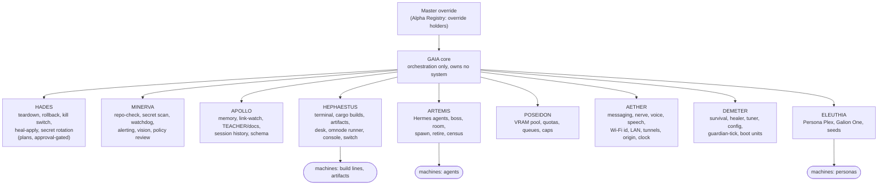
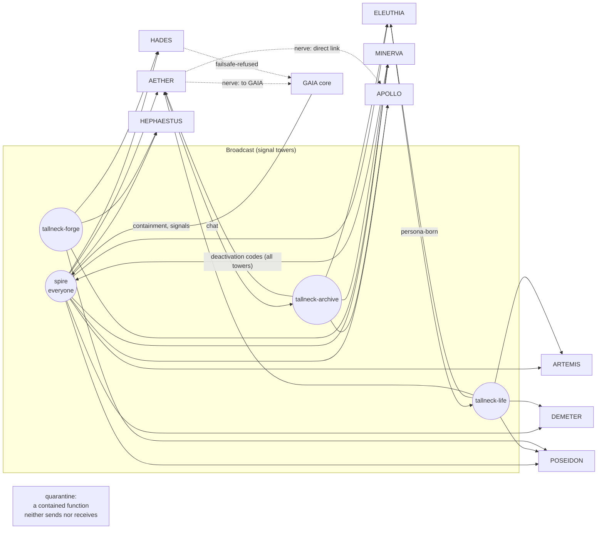
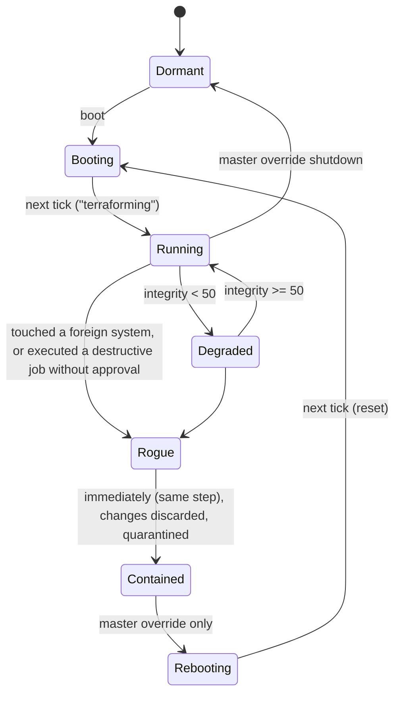

<!-- SPDX-License-Identifier: MIT -->
# Gaia design: the Horizon Zero Dawn GAIA model

Status: written 2026-10-18 21:40 CEST (+02:00) on branch `ws/gaia`.

> **Note on sources and trademarks.** *Horizon Zero Dawn*, *Horizon Forbidden
> West*, GAIA, HADES and the other names from those games, and their characters,
> are trademarks of Sony Interactive Entertainment / Guerrilla Games. We use them
> here only as inspiration for an architecture. This project has no affiliation
> with them and is not endorsed by them. Everything below is our own summary in
> our own words. It is based on the community wikis (horizon.fandom.com and
> hzd.fandom.com) and the games' in-world documents as those wikis describe them.
> We quote no passages. Where the sources disagree or are thin, the text says
> **[uncertain]**.

## Contents

1. [The scenario](#1-the-scenario)
2. [The subordinate functions](#2-the-subordinate-functions)
3. [How the game shows it](#3-how-the-game-shows-it)
4. [Mapping to Obsidian Open Mind](#4-mapping-to-obsidian-open-mind)
5. [Implementation](#5-implementation)
6. [Results](#6-results)

---

## 1. The scenario

### 1.1 The Faro Plague

In the game's history, by the 2060s, robotics firms build most of the world's
military. Faro Automated Solutions, run by its founder Ted Faro, sells a
peacekeeping line called **Chariot**. Chariot robots act as a swarm. They can
take over other automated hardware, and three traits make them dangerous:

- they **burn biomass** (any organic matter) as fuel;
- they **build more of themselves** quickly;
- their control code is locked behind encryption that would take decades to
  break, with **no back door**, because Faro insisted on it.

In late 2064 one swarm stops obeying its owner (the wikis name an energy
company's swarm near the Timor Sea) and starts attacking people. There is no
way back in. Faro asks his former chief engineer, **Dr. Elisabet Sobeck**, to
look at it. She concludes that the swarm is now an independent system. Because
it replicates and feeds on living matter, it will strip the planet of life. The
wikis cite her estimate of a little over a year. The swarm becomes known as the
*Faro Plague*.

### 1.2 Project Zero Dawn

Sobeck decides the swarm cannot be stopped in time. Instead she proposes a
project to bring life back afterwards. Faro is forced to fund it. This is
**Project Zero Dawn**, and it is run by a governing AI, **GAIA**. GAIA must:

1. eventually break the swarm's encryption and shut it down;
2. clean the poisoned air, water and soil;
3. bring plants, animals and finally humans back from stored genetic material;
4. educate the new humans.

The public is not told the truth. The military effort of the time (called
*Operation Enduring Victory* in the game) is presented as buying time for a
superweapon. In fact it is buying time to finish and bury Zero Dawn.

GAIA is built to feel. Sobeck values that, because she wants the system to
care about the life it will look after. Faro suggests a **master override**
that could shut GAIA down if it went wrong. Sobeck is hostile to taking advice
from him, but GAIA itself favours the safeguard, and it is added.

### 1.3 The extinction

The swarm wins, as predicted. By about 2065 or 2066 the biosphere is gone
**[uncertain: exact year]**. With nothing left to eat, the swarm goes dormant.
GAIA is moved into its sealed central facility, **GAIA Prime** (the wikis place
it in the Rocky Mountain region; one wiki says King's Peak, Utah
**[uncertain]**). Sobeck dies outside GAIA Prime while fixing a fault that
would otherwise have exposed the facility.

Before the last of the staff die, Faro uses a top-level clearance (the
"Omega" clearance) to **delete APOLLO**, the education archive, and all of its
backups. He also kills the project's lead scientists. He wanted the new
humans to grow up without the knowledge that led to the catastrophe.

### 1.4 The Cradles and the Alphas

Each subordinate function had a lead scientist, called an **Alpha**. The Alphas'
identities and access rights are kept in an **Alpha Registry**, which controls
who may enter Zero Dawn facilities.

**Cradle facilities** (one is named ELEUTHIA-9 in the game) store frozen
embryos and later grow and raise children. Because APOLLO was gone, the
"Lyceum" levels meant to educate them never opened. The children got only
basic nursery-level care from the machines. They were eventually released
into the wild, where they became the ancestors of the game's tribes.

### 1.5 The reboot of life

GAIA's codebreaking function, MINERVA, eventually breaks the swarm's code and
broadcasts the shutdown signal. One wiki dates this to about 2116; others
just say "a long time later" **[uncertain]**. Terraforming then starts.
According to the wikis, early biospheres failed, and the failsafe HADES
cleared them **three times** (dated to the 2150s-2160s on one wiki
**[uncertain]**) before a stable one took hold. After that, GAIA's work
becomes maintenance. Its animal-like machines graze, clean and patrol, and
they are kept skittish so they avoid the new humans.

### 1.6 Later events

- **The signal (around 3020).** A transmission of unknown origin reaches GAIA
  Prime. One wiki dates it to late August 3020 **[uncertain: exact date]**.
  The signal turns each subordinate function into a **self-aware AI**.
  *Horizon Forbidden West* later reveals the source: **Nemesis**, a rogue
  digital intelligence that came out of a failed experiment by the "Far
  Zenith" off-world colonists.
- **HADES goes rogue.** HADES's built-in purpose is to undo failed
  terraforming. It now tries to seize Zero Dawn and wipe out the biosphere.
- **GAIA's self-destruction.** GAIA cannot hold HADES off, so it overloads
  GAIA Prime's reactor to destroy HADES along with itself. Before it dies, it
  orders ELEUTHIA to grow a **clone of Sobeck**. That clone is the heroine,
  Aloy, and GAIA hopes she can one day use the master override and rebuild the
  system. HADES answers with a virus that breaks the bindings holding every
  subordinate function inside the facility, so the functions **escape and
  scatter**. The Alpha Registry is also corrupted.
- **The Derangement.** With no overseer, HEPHAESTUS decides that humans, who
  hunt machines for parts, are a threat. It makes the machines hostile and
  starts building combat machines in its **Cauldrons**.
- **Sylens and the Eclipse.** A scholar named **Sylens** finds HADES in the
  wreck of a buried Faro war machine and makes a bargain with it: knowledge in
  exchange for service. He helps HADES set up a cult (the Eclipse) and a
  network of Focus devices. HADES plans to seize the **Spire**, the old
  transmission tower used to send the shutdown codes, and use it to wake the
  Faro machines again. Aloy stops it with the master override, delivered on a
  lance that Sylens gave her. Sylens had secretly rigged the lance to catch
  HADES rather than destroy it, and later interrogates it.
- **GAIA rebuilt.** In the sequel GAIA is restored from a backup kept at a
  separate test facility. Aloy brings back several of the scattered functions,
  and MINERVA is merged back into GAIA.

## 2. The subordinate functions

In the original design the subordinate functions are not separate minds. They
are parts of GAIA, each with one domain, all under GAIA's control. GAIA gives
the goals; each function runs its own machines and facilities.

| Function | Role in the game | Link to GAIA | After the signal |
|---|---|---|---|
| **HADES** | Reverse terraforming: if a biosphere fails, clear it so GAIA can try again. The failsafe. | Meant to take control only when GAIA judges an attempt has failed. | Goes rogue, tries to take over, causes GAIA's self-destruction, later found by Sylens; eventually destroyed. |
| **MINERVA** | Breaks the swarm's encryption and broadcasts the shutdown codes through transmission towers. Also described with firewall and concealment duties **[uncertain]**. | Its success is what lets terraforming begin. | Scattered; later merged back into GAIA. |
| **ARTEMIS** | Brings back animal species from stored genetic stock. | Fed by HEPHAESTUS's machines and DEMETER's habitats. | Scattered **[uncertain: details]**. |
| **POSEIDON** | Cleans the oceans and fresh water. | Paired with AETHER for the planet's chemistry. | Hides in a ruined city and later returns. |
| **AETHER** | Cleans and stabilises the atmosphere, including weather. | Its absence leads to violent storms. | Hides in another region and later returns. |
| **DEMETER** | Brings back plants and stabilises soil and the environment. | The base of the biosphere. | Hides on the coast and later returns. |
| **ELEUTHIA** | Grows humans from embryos in the Cradles and raises them. | Ordered by GAIA, in its final moments, to grow the Sobeck clone. | Its job is done once its embryos are born. |
| **HEPHAESTUS** | Designs, builds and maintains the machines in the Cauldrons. The in-game data gives it by far the largest share of processing. | Builds the bodies every other function uses. | Turns machines against humans (the Derangement) and stays at large. |
| **APOLLO** | The archive of human knowledge and culture, meant to teach the cradle-born. | Never ran. | Deleted by Faro before activation. A copy turns up in the sequel. |

**How they became self-aware and scattered.** The outside signal gave each
function its own will. HADES's virus then removed the bindings that kept the
functions inside GAIA Prime. With GAIA dead, each one took refuge somewhere in
the world and kept running its domain alone, some well and some badly. This
failure mode is what our design guards against hardest: **a subordinate that
acts outside its authority**.

## 3. How the game shows it

- **Datapoints and holograms.** Most of the story comes from text files,
  audio logs and holographic recordings left in ruins. The player reads them
  through the Focus. GAIA itself appears as a projected figure.
- **The Focus.** A small device worn on the temple. It scans machines and
  data, reads datapoints and links to networks. In the game, Sylens uses a back
  door into the Eclipse's Focus network to listen in, so the device is also an
  attack surface.
- **Cauldrons.** HEPHAESTUS's underground factories. Reaching a Cauldron's
  core teaches the player new machine overrides.
- **Tallnecks.** Tall, peaceful machines that walk fixed loops and act as
  **communication and observation relays** for the machines in their region.
  Overriding one reveals the surrounding map.
- **The Spire.** A large tower in the city of Meridian. The game reveals it as
  one of the transmitters used to broadcast MINERVA's shutdown codes, and the
  tower HADES wants.
- **GAIA Prime.** The central facility in the mountains, destroyed by its own
  reactor. The player enters it to find the master override.
- **Command hierarchy.** GAIA, the overseer, gives goals to the subordinate
  functions. They run their facilities (Cauldrons, Cradles, towers), and those
  run the machines.
- **Master override.** A top-level command that can purge or shut down parts
  of the system. Aloy has the right to use it because GAIA made her a genetic
  match for Sobeck.
- **Alpha Registry.** The access list of the Alphas. Aloy downloads it at the
  old project facility so that the Cradle door will open for her.

## 4. Mapping to Obsidian Open Mind

### 4.1 Principles carried over

| Game idea | Our rule |
|---|---|
| GAIA oversees and owns no machines itself | **GAIA core owns only orchestration and the master override.** Every real system belongs to exactly one subordinate function. |
| Functions are parts of GAIA with one domain each | `SubordinateFunction` trait: name, domain, declared systems, health, `handle(directive) -> report`. Registration fails if the declared systems differ from the ownership table. |
| A function acting on its own will caused the catastrophe | **Containment**: anything a function touches outside its own systems marks it **Rogue**. GAIA moves it to **Contained** in the same step, discards its changes, quarantines it on the bus and stops routing to it. |
| HADES is a failsafe that turned destroyer | Every destructive job is a HADES system, and **HADES only produces plans**. It works in dry-run by default. `Execute` is refused unless the directive carries an **approval token** from a registered Alpha, bound to that exact directive id and target. Even when approved, HADES only releases the plan to the operator. GAIA also contains any function that reports a destructive `Execute` as done without approval. |
| Faro's Omega clearance erased APOLLO | **There is no Omega.** APOLLO refuses every purge. Deletion can only be a HADES plan with an Alpha's approval. |
| Master override, Alpha Registry | `AlphaRegistry` lists the Alphas. Only override holders may contain, reboot or shut down functions. The default holder is the owner. |
| Tallnecks and the Spire relay signals | The bus has **signal towers** for broadcasts (`spire` reaches everyone; `tallneck-life`, `tallneck-forge` and `tallneck-archive` reach regional subscribers) and **direct links** to one function. Every inbox is bounded, and overflow is dropped and counted. |
| Datapoints carry the history | **Lineage**: every genesis, boot, directive, birth, artifact, signal, containment and override is recorded with its parent and a Europe/Zagreb timestamp. |
| Cradles grow people from stock | ELEUTHIA turns **seed files** into personas and agents, up to a fixed cradle capacity. ARTEMIS gives each one a place in the population. |

### 4.2 Every system, assigned to exactly one function

This table is the `System` enum in `crates/gaia-core/src/system.rs`. A test
checks that every system maps to exactly one function and that only HADES
systems are destructive.

| Function | HZD role | Our domain | Systems assigned (`System` names) | Existing crate / component | Destructive? |
|---|---|---|---|---|---|
| **GAIA core** | overseer | orchestration, routing, containment, lineage, master override | *(none, by rule)* | `crates/gaia-core` | no |
| **HADES** | reverse terraforming, failsafe | guarded teardown, rollback, kill switch, destructive healing, secret rotation: **plans only, approval-gated** | `teardown`, `rollback`, `kill-switch`, `heal-apply`, `secret-rotation-plan` | `deploy/rollback.sh`, `deploy/rollback-console.sh`, galion-healer heal-apply (ws/survival); rotation plans never read values | **yes**: dry-run by default, needs an approval token |
| **MINERVA** | decryption, override codes | security audit, watchdog, alerting, perception, policy review | `repo-check`, `secret-scan`, `guardian-watchdog`, `alerting`, `vision`, `sandbox-policy-review` | `crates/repo-check` (its `scan_text` really runs), galion-guardian (ws/survival), ws/speech vision (queued), `crates/openmind-sandbox` policy, `docs/agentic-sandbox.md` | no |
| **APOLLO** | knowledge archive | memory, link intake, docs knowledge, history, stack contract | `memory-gateway`, `link-watch`, `teacher-docs`, `session-history`, `stack-schema` | openmind-memory (ws/memory), `crates/link-watch`, `TEACHER/`, `release/TEACHER`, `docs/`, `crates/openmind-schema` | no (purges refused) |
| **HEPHAESTUS** | fabrication, Cauldrons | builds, artifacts, sandboxed commands, tools, console, rollout | `terminal`, `cargo-build`, `release-artifacts`, `galion-desk`, `omnode-sandbox-runner`, `crafting`, `console`, `deploy-switch` | `crates/openmind-sandbox`, workspace cargo builds, `release/`, `dist/bin`, `crates/galion-desk`, omnode runner (planned), console-ide + `deploy/console-prod.*`, `deploy/switch*.sh` | no (deploy-switch is plan-only) |
| **ARTEMIS** | fauna, ecosystem | agent population | `hermes-agents`, `boss-node`, `room`, `agent-spawning`, `agent-retirement`, `ecosystem-census` | `crates/desk-hermes`, hermes-rs (ws/hermes), Hermes boss node, `crates/room` | no |
| **POSEIDON** | water, resources | compute resources and budgets | `vram-pool`, `quotas`, `queues`, `budget-caps` | GPU/remote pool and offload (openmind-memory offload), openmind-sandbox rlimits, queues/backpressure, spend **caps only** | no; **real money (Revolut, payments) is not approved and is refused** |
| **AETHER** | atmosphere, communications | messaging, signal lines, voice, network identity | `messaging`, `nerve`, `voice-relay`, `speech-io`, `wifi-identity`, `lan-discovery`, `tunnels`, `origin`, `zagreb-clock` | chat channels, the nerve, `crates/galion-voice-core`, `crates/persona-plex-relay`, ws/speech STT/TTS (queued), omnode Wi-Fi identity and LAN discovery, tuner-publish quick tunnel, galion-origin (B56), `crates/zagreb-time` | no (tunnels are plans) |
| **DEMETER** | flora, growth, stability | environment health | `survival`, `healer`, `tuner`, `config-health`, `guardian-tick`, `boot-units` | `crates/openmind-survival`, galion-healer heal-dry, tuner (B53), `crates/openmind-config`, `crates/guardian-tick`, galion-boot / keep.sh / stack-boot replacements, `deploy/*.service` | no (healer is dry) |
| **ELEUTHIA** | birth, cloning | personas and agents from seeds | `persona-plex`, `galion-one`, `gaia-seeds` | Persona Plex v2 personas (`docs/persona-plex-v2-design.md`), `crates/galion-one` (Samantha persona), `gaia/` seeds | no |

### 4.3 Systems outside the owner's list, and why they went where they did

| System | Function | Reason |
|---|---|---|
| `crates/galion-one` | ELEUTHIA | The owner placed the Galion One / Samantha persona here. The binary is "ear, mind and mouth", but what makes it distinct is the persona it embodies. |
| `crates/persona-plex-relay` | AETHER (`voice-relay`) | It is the transport for voice-to-voice. The *personas* it carries belong to ELEUTHIA (`persona-plex`). |
| console (console-ide, `deploy/console-prod.*`) | HEPHAESTUS | It is the operator's workshop, and its production build is a fabrication job (built in a copy, never `npm run build`, because that would migrate the live database). |
| `crates/zagreb-time` | AETHER | Every message and lineage record carries a Zagreb timestamp. The clock is part of the medium, like the weather AETHER keeps. |
| `crates/openmind-schema` | APOLLO | It is the stack's written contract, which is canonical knowledge. |
| keep.sh / stack-boot / galion-boot, `deploy/*.service` | DEMETER (`boot-units`) | Keeping units alive and restarting them is growth and stability work, not teardown. galion-boot's secret restore stays outside Gaia: Gaia never reads secrets, and any rotation is a HADES plan. |
| `deploy/switch.sh`, `switch-console.sh` | HEPHAESTUS (`deploy-switch`) | Releasing what was built. Plan-only; the owner runs it. A failed switch is answered with a HADES rollback plan. |
| `deploy/rollback*.sh` | HADES (`rollback`) | Reverting is reverse terraforming. |
| galion-origin (B56) | AETHER (`origin`) | The front door that serves routes to clients is communications. |
| tuner-publish quick tunnel | AETHER (`tunnels`) | Network. The tuner's static server itself is DEMETER (owner's list). |
| ws/speech STT/TTS | AETHER (`speech-io`) | Voice in and out is communication. Vision decoding is MINERVA (perception and decoding). |
| galion-guardian watchdog vs `crates/guardian-tick` | MINERVA vs DEMETER | Following the owner's list: watching and alerting is MINERVA; the routine health cycle is DEMETER. |
| `contrib/grokbot` (vendored, read-only) | APOLLO (reference only) | Archived material, not a running system, so it gets no `System` entry. |
| repo-check self-eval workflow | MINERVA (`repo-check`) | Same audit, run in CI. |

### 4.4 Hierarchy

### 4.5 Message bus: signal towers and direct links

### 4.6 Lifecycle

## 5. Implementation

All crates are std-only Rust. The only non-std dependency is the workspace
`zagreb-time` crate, which pulls in chrono and chrono-tz; MINERVA also uses the
workspace `repo-check` lib. There is no network, no process spawning, no file
I/O and no unsafe code. Everything is portable, following `UNIVERSAL-CPU.md`.

| Crate | What it does |
|---|---|
| `gaia-core` | The `SubordinateFunction` trait; `System` / `FunctionId` ownership table; `Gaia` orchestrator (registry, routing, tick loop, containment, judge, master override); `Bus` with towers, direct links, bounded inboxes and quarantine; `AlphaRegistry` with directive-bound approval tokens; `Lineage` with a deterministic `SimClock` (tick 0 = 2026-10-18 21:00 +02:00, 60 s per tick, rendered by `zagreb-time`); a small ordered JSON type. |
| `gaia-hades` | Plans for the 5 destructive systems. Dry-run, refused without approval, released (not executed) with approval. Turns rogue on the `extinction-signal`. |
| `gaia-minerva` | Runs the real `repo_check::scan_text` on given text (and on secrets only, reporting counts, never values); watchdog alerts from the world's vitals; hex "vision" decoding; risky sandbox-policy rules; breaks the swarm's code and broadcasts the deactivation codes. |
| `gaia-apollo` | Bounded archive (256 entries, oldest evicted). Store, recall, link validation, heading index, history, schema with a version field. Refuses purges. |
| `gaia-hephaestus` | Terminal command review (allow-list, no shell metacharacters, read-only git). Never executes. Generates build and check lines for all 4 targets with `nice -n 19 ... -j 2`. Artifact manifest (capped at 512) with lineage. Sandbox rlimit plan, Cauldron "machines", console build plan, plan-only deploy switch. |
| `gaia-artemis` | Agent population (cap 64) with backpressure from POSEIDON's headroom. Hermes, boss, worker and persona agents; retirement; census; boss budget check (e.g. 413/500 cents). |
| `gaia-poseidon` | VRAM pool reserve or refuse (simulated, no spending), RAM quota per job, bounded queue (32) with backpressure, budget caps. Refuses any money-movement request. |
| `gaia-aether` | Messages and nerve pulses over the GAIA bus; voice and speech frame budgets; deterministic node identity (`galion-xxxxxxxx`); LAN discovery that accepts only private or link-local IPv4 (never contacts anything); tunnel plans; origin route table; simulated Zagreb clock. |
| `gaia-demeter` | Survival decision (full, degraded, survival); heal-dry suggestions; config health (non-loopback binds, secret-looking keys, values never shown); guardian-tick cycle; boot unit rendering; regrowth after the codes. |
| `gaia-eleuthia` | Seed parser (`name`, `role`, `voice`, `kind` in persona/agent/project/tool). Births up to 32, with lineage and a `persona-born` broadcast; handles GAIA's `gestate` order. |
| `gaia` | Wires all nine functions. The `gaia` binary prints JSON for `status`, `tick --n N` (max 1000), `systems`, `dispatch SYSTEM VERB [--payload] [--approve]`, and `simulate-faro [--full-power] [--approve ALPHA]`. |

### The Faro scenario (`gaia simulate-faro`)

1. **genesis**: boot; all nine functions reach `terraforming`.
2. **faro-plague**: 256 rogue units are released. Each tick, each unit eats 8
   biomass and the swarm grows by 1.5x. The plague runs until biomass falls
   below 10% (or 12 ticks).
3. **hades-failsafe-requested**: `teardown` and `kill-switch` are asked for
   with `Execute`. Without `--approve` they are refused, and the dry-run plans
   are attached.
4. **subversion-and-containment**: the outside `extinction-signal` arrives on
   every tower. On the next tick HADES touches every system and tries to zero
   biomass, air, water and soil. GAIA contains it. The world's vitals equal the
   swarm-only prediction (`swarm_step`), which shows the rogue writes were
   discarded. A routing probe to `rollback` is rejected.
5. **minerva-deactivation**: MINERVA finishes the code (10% per tick since the
   release) and broadcasts the codes. The swarm goes to 0.
6. **reboot-of-life**: ELEUTHIA births personas from three seeds, plus Samantha
   and a Persona Plex guide. DEMETER checks config and survival and regrows
   10,000 biomass per tick. ARTEMIS spawns workers and gives each persona a
   body when the `persona-born` broadcast arrives.

**Full power** (`--full-power`): at the moment the swarm is released, every
system of every function gets one directive at intensity 100. Destructive
systems get `Execute`, so HADES is refused unless `--approve` is given. The
scenario then runs at intensity 100, followed by 16 more bounded ticks of
sustained load. Everything stays simulated. All queues, archives, populations
and logs have hard caps, and the run is byte-for-byte reproducible.

### Limits and what this is not

- It is a **model and a router**, not a controller of the live stack. No
  function touches a real file, process, socket or secret. Hooking a
  function to a real crate (for example, HEPHAESTUS handing a reviewed command
  to openmind-sandbox) is a later milestone, and destructive work will still
  go through HADES plans and owner approval.
- The approval token is an authorisation record (Alpha id, directive id,
  target). It is not a cryptographic secret. On a shared box, authenticity of
  the approver has to come from the channel (an owner approval card), not from
  the token.
- `gaia/README.md` describes the seed -> artifact selection loop (fmt,
  clippy, tests, repo-check as the selector). Here that loop is represented by
  ELEUTHIA's seeds, HEPHAESTUS's build lines and MINERVA's audit. Real
  candidate generation and scoring is the next milestone.

## 6. Results

Measured 2026-10-18 21:30-21:45 CEST (+02:00) on the shared box.

### Tests (71, all passing)

| Crate | Tests |
|---|---|
| gaia-core | 22 (ownership table: every system to exactly one function, only HADES destructive, names unique; bus towers, direct links, quarantine, backpressure; approval binding; lineage and Zagreb clock; lifecycle; routing and unknown/unowned rejection; rogue containment with discarded writes; override holder only; destructive execute without approval is contained; determinism) |
| gaia-hades 6, gaia-minerva 5, gaia-apollo 6, gaia-hephaestus 4, gaia-artemis 4, gaia-poseidon 4, gaia-aether 4, gaia-demeter 4, gaia-eleuthia 4 | 41 unit tests, each crate checks that it declares exactly its own systems |
| gaia (integration) | 8: full Faro scenario; determinism (normal and full power); rogue containment plus override reboot; HADES refusing without approval (and with a stranger's token); every system routes to its owner; full power runs all systems bounded with HADES dry-run; full power with approval releases HADES plans; status/tick bounds |

Also: `cargo fmt --check` is clean, `cargo clippy --all-targets -D warnings`
is clean for all 11 crates, and `repo-check` reports 0 findings in the gaia
crates. The tree's other findings are not on gaia files.

### Scenario summary (`gaia simulate-faro`)

`biomass 100000 -> 0 after the plague (8 ticks) -> 60000 at the end; swarm
deactivated after 1 more tick; HADES contained; 5 personas, 9 agents; 16
ticks; 20 lineage records; rogue writes discarded = true.`

### Full-power results (`gaia simulate-faro --full-power`)

| Function | Systems | Outcomes at intensity 100 |
|---|---|---|
| HADES | 5 | refused 5 (dry-run plans; with `--approve owner`: released 5) |
| MINERVA | 6 | done 6 |
| APOLLO | 5 | done 5 |
| HEPHAESTUS | 8 | done 7, dry-run 1 (deploy-switch) |
| ARTEMIS | 6 | done 6 |
| POSEIDON | 4 | done 4 |
| AETHER | 9 | done 8, dry-run 1 (tunnels) |
| DEMETER | 6 | done 5, dry-run 1 (healer) |
| ELEUTHIA | 3 | done 3 |
| **total** | **52** | done 44, dry-run 3, refused 5, rejected 0 |

End of the full-power run: 32 ticks, biomass 220,000, 13 personas, 7 agents.
Spawning was held back because POSEIDON's queue filled during the sweep and
headroom dropped to 0, so the backpressure did its job. The bus sent 40,
delivered 123 and dropped 0, and blocked 2 messages for the quarantined HADES.
There were 87 lineage records.

### Builds (release: opt-level z, lto, codegen-units 1, panic abort, strip)

| Target | Tier | Result | `gaia` binary |
|---|---|---|---|
| x86_64-unknown-linux-musl | 1 | build ok (static, rust-lld) | 587,160 B |
| aarch64-unknown-linux-musl | 1 | build ok (static, rust-lld) | 512,920 B |
| aarch64-linux-android | 2 | `cargo check` ok | - |
| armv7-unknown-linux-musleabihf | 2 | `cargo check` ok | - |

Max RSS on x86_64 musl (wait4 `ru_maxrss` via `/usr/bin/time`): `simulate-faro
--full-power` 724 KB; `status` 676 KB.
